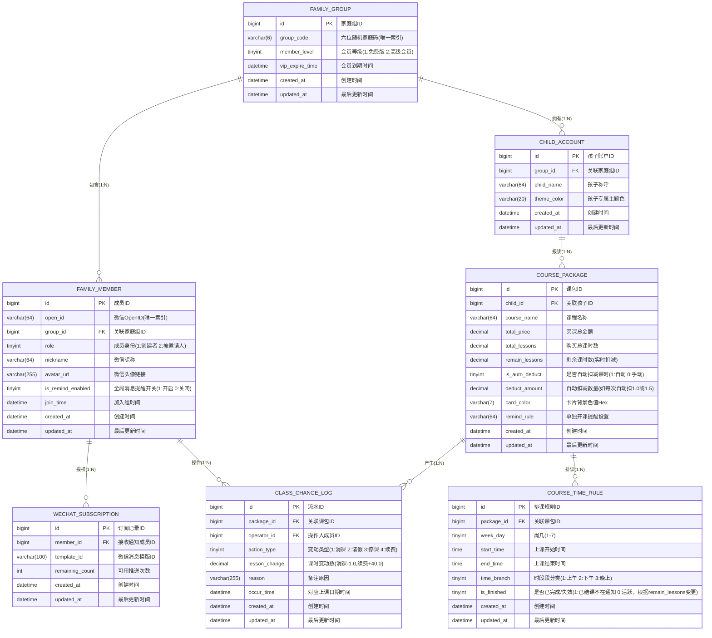

将项目划分为以下 5 个核心业务模块：

1. 家庭组与成员模块：family
执行命令： nest g resource modules/family

承载数据表： family_group（家庭组表）、family_member（家庭成员表）

业务职责： * 处理微信一键登录与自动建组逻辑。

生成和校验“六位随机家庭码（group_code）”。

处理多成员合并账本、一键邀请、家庭成员列表回显等协同核心逻辑。

2. 孩子账户模块：child
执行命令： nest g resource modules/child

承载数据表： child_account（孩子账户表）

业务职责： * 管理孩子账户的创建、主题色设置。

为首页提供多孩子列表切换的接口。

3. 课程与排课模块：course
执行命令： nest g resource modules/course

承载数据表： course_package（课包表）、course_time_rule（排课规则表）

业务职责： * 核心资产包的录入、剩余价值动态计算。

核心亮点： 负责将底层的 course_time_rule 列表数据，在 Service 层组装成前端需要的 JSON 矩阵格式，用来完美回显【超级课程表】的全周网格。

4. 消课流水账单模块：lesson-log
执行命令： nest g resource modules/lesson-log

承载数据表： class_change_log（消课流水变动表）

业务职责： * 处理核心的“确认消课（-1）”、“标记请假（0）”、“续费充值（+N）”接口。

为详情页的“对账月日历”提供按月份筛选有课/请假圆点的图形化数据接口。

提供5秒内撤销消课的反悔接口。

5. 微信通知与订阅模块：notification
执行命令： nest g resource modules/notification

承载数据表： wechat_subscription（微信订阅记录表）

业务职责： * 接收前端用户点击授权后的订阅次数上报（增加可用次数）。

定时任务宿主（关键）： 配合 NestJS 选型的定时任务插件（如 @nestjs/schedule），每分钟或每小时扫描 course_time_rule，通过高效 SQL 筛选出需要推送的人群，调用微信 Template Message 接口发送开课提醒。
