# IMPL-002: DAO 层与 CRUD 架构 - 开发计划

## 计划概述

**目标**: 为 wx-nest 项目的 7 个实体模块添加完整的 DAO 层和 CRUD 功能支持

**技术栈**:
- NestJS 11.x
- TypeORM 1.x
- nestjs-paginate

**预计工时**: 1-2 天

**涉及实体**:
1. ChildAccount (child 模块)
2. FamilyGroup (family 模块)
3. FamilyMember (family 模块)
4. CoursePackage (course 模块)
5. CourseTimeRule (course 模块)
6. ClassChangeLog (lesson-log 模块)
7. WechatSubscription (notification 模块)

---

## 实施进度表

```mermaid
gantt
    title DAO 层与 CRUD 架构开发进度
    dateFormat  HH:mm
    axisFormat  %H:%M

    section 阶段一：基础设施
    安装依赖          :a1, 00:00, 5m
    创建 BaseDao      :a2, after a1, 15m

    section 阶段二：Child 模块
    创建 ChildAccountDao      :b1, after a2, 15m
    重构 ChildService         :b2, after b1, 20m
    更新 ChildModule          :b3, after b2, 5m

    section 阶段三：Family 模块
    创建 FamilyGroupDao       :c1, after b3, 10m
    创建 FamilyMemberDao      :c2, after c1, 10m
    重构 FamilyService        :c3, after c2, 20m
    更新 FamilyModule         :c4, after c3, 5m

    section 阶段四：Course 模块
    创建 CoursePackageDao     :d1, after c4, 10m
    创建 CourseTimeRuleDao    :d2, after d1, 10m
    重构 CourseService        :d3, after d2, 20m
    更新 CourseModule         :d4, after d3, 5m

    section 阶段五：其他模块
    LessonLog 模块             :e1, after d4, 15m
    Notification 模块         :e2, after e1, 15m

    section 阶段六：验证测试
    CRUD 功能测试             :f1, after e2, 20m
    分页功能测试              :f2, after f1, 15m
    异常处理测试              :f3, after f2, 15m
```



---

## 阶段一：基础设施

### 任务 1.1: 安装依赖包

**文件**: `package.json`

**步骤**:

**步骤 1: 安装 nestjs-paginate**

```bash
pnpm add nestjs-paginate
```

**验收标准**:
- [ ] package.json 中包含 `nestjs-paginate`
- [ ] pnpm install 无报错

---

### 任务 1.2: 创建 BaseDao 通用基类

**文件**:
- 创建: `src/common/dao/base.dao.ts`

**步骤**:

**步骤 1: 创建 base.dao.ts**

```typescript
import { InjectRepository } from '@nestjs/typeorm';
import { Repository, DeepPartial, FindOptionsWhere } from 'typeorm';
import { Injectable } from '@nestjs/common';
import { PaginateQuery, Paginated, paginate } from 'nestjs-paginate';

@Injectable()
export abstract class BaseDao<T> {
  constructor(
    @InjectRepository() protected readonly repository: Repository<T>,
  ) {}

  create(data: DeepPartial<T>): Promise<T> {
    const entity = this.repository.create(data);
    return this.repository.save(entity);
  }

  findOne(id: string): Promise<T | null> {
    return this.repository.findOne({ where: { id } as FindOptionsWhere<T> });
  }

  findMany(filter?: FindOptionsWhere<T>): Promise<T[]> {
    return this.repository.find({ where: filter });
  }

  async update(id: string, data: DeepPartial<T>): Promise<T> {
    await this.repository.update(id, data);
    return this.findOne(id);
  }

  delete(id: string): Promise<void> {
    return this.repository.delete(id).then(() => {});
  }

  paginate(query: PaginateQuery): Promise<Paginated<T>> {
    return paginate(query, this.repository, {
      sortableColumns: ['id', 'createdAt', 'updatedAt'],
      defaultSortBy: [['id', 'DESC']],
    });
  }
}
```

**验收标准**:
- [ ] 文件创建成功
- [ ] 无 TypeScript 编译错误
- [ ] 包含所有基础 CRUD 方法

---

## 阶段二：Child 模块（示例实现）

### 任务 2.1: 创建 ChildAccountDao

**文件**:
- 创建: `src/modules/child/dao/child-account.dao.ts`

**步骤**:

**步骤 1: 创建 child-account.dao.ts**

```typescript
import { Injectable } from '@nestjs/common';
import { InjectRepository } from '@nestjs/typeorm';
import { Repository } from 'typeorm';
import { ChildAccount } from '../entities/child-account.entity';
import { BaseDao } from '@/common/dao/base.dao';

@Injectable()
export class ChildAccountDao extends BaseDao<ChildAccount> {
  constructor(
    @InjectRepository(ChildAccount)
    repository: Repository<ChildAccount>,
  ) {
    super(repository);
  }

  // 复杂查询方法（按需添加）
  async findByGroupId(groupId: string): Promise<ChildAccount[]> {
    return this.repository.find({
      where: { groupId },
      relations: ['group'],
    });
  }
}
```

**验收标准**:
- [ ] 文件创建成功
- [ ] 继承 BaseDao
- [ ] 包含 findByGroupId 方法

---

### 任务 2.2: 重构 ChildService

**文件**:
- 修改: `src/modules/child/child.service.ts`
- 移动到: `src/modules/child/services/child.service.ts`

**步骤**:

**步骤 1: 重写 child.service.ts**

```typescript
import { Injectable, NotFoundException } from '@nestjs/common';
import { ChildAccountDao } from '../dao/child-account.dao';
import { CreateChildDto } from '../dto/create-child.dto';
import { UpdateChildDto } from '../dto/update-child.dto';
import { ChildDto } from '../dto/child.dto';
import { Paginated, PaginateQuery } from 'nestjs-paginate';

@Injectable()
export class ChildService {
  constructor(private readonly childDao: ChildAccountDao) {}

  async create(dto: CreateChildDto): Promise<ChildDto> {
    const entity = await this.childDao.create(dto);
    return this.toDto(entity);
  }

  async findAll(query: PaginateQuery): Promise<Paginated<ChildDto>> {
    const result = await this.childDao.paginate(query);
    return {
      ...result,
      data: result.data.map((entity) => this.toDto(entity)),
    };
  }

  async findOne(id: string): Promise<ChildDto> {
    const entity = await this.childDao.findOne(id);
    if (!entity) {
      throw new NotFoundException(`Child ${id} not found`);
    }
    return this.toDto(entity);
  }

  async update(id: string, dto: UpdateChildDto): Promise<ChildDto> {
    const entity = await this.childDao.update(id, dto);
    if (!entity) {
      throw new NotFoundException(`Child ${id} not found`);
    }
    return this.toDto(entity);
  }

  async remove(id: string): Promise<void> {
    const entity = await this.childDao.findOne(id);
    if (!entity) {
      throw new NotFoundException(`Child ${id} not found`);
    }
    await this.childDao.delete(id);
  }

  private toDto(entity: ChildAccount): ChildDto {
    return {
      id: entity.id,
      groupId: entity.groupId,
      childName: entity.childName,
      themeColor: entity.themeColor,
      createdAt: entity.createdAt,
      updatedAt: entity.updatedAt,
    };
  }
}
```

**验收标准**:
- [ ] Service 注入 ChildAccountDao
- [ ] 实现所有 CRUD 方法
- [ ] 包含异常处理

---

### 任务 2.3: 更新 ChildModule

**文件**:
- 修改: `src/modules/child/child.module.ts`

**步骤**:

**步骤 1: 注册 ChildAccountDao**

```typescript
import { Module } from '@nestjs/common';
import { TypeOrmModule } from '@nestjs/typeorm';
import { ChildAccount } from './entities/child-account.entity';
import { ChildAccountDao } from './dao/child-account.dao';
import { ChildService } from './services/child.service';
import { ChildController } from './child.controller';

@Module({
  imports: [TypeOrmModule.forFeature([ChildAccount])],
  providers: [
    ChildAccountDao,
    ChildService,
  ],
  controllers: [ChildController],
  exports: [ChildService],
})
export class ChildModule {}
```

**验收标准**:
- [ ] ChildAccountDao 注册为 provider
- [ ] 模块导入 TypeOrmModule.forFeature
- [ ] 应用正常启动

---

## 阶段三：Family 模块

### 任务 3.1: 创建 FamilyGroupDao

**文件**:
- 创建: `src/modules/family/dao/family-group.dao.ts`

**步骤**:

**步骤 1: 创建 family-group.dao.ts**

```typescript
import { Injectable } from '@nestjs/common';
import { InjectRepository } from '@nestjs/typeorm';
import { Repository } from 'typeorm';
import { FamilyGroup } from '../entities/family-group.entity';
import { BaseDao } from '@/common/dao/base.dao';

@Injectable()
export class FamilyGroupDao extends BaseDao<FamilyGroup> {
  constructor(
    @InjectRepository(FamilyGroup)
    repository: Repository<FamilyGroup>,
  ) {
    super(repository);
  }

  async findByGroupCode(groupCode: string): Promise<FamilyGroup | null> {
    return this.repository.findOne({ where: { groupCode } });
  }
}
```

**验收标准**:
- [ ] 文件创建成功
- [ ] 包含 findByGroupCode 方法

---

### 任务 3.2: 创建 FamilyMemberDao

**文件**:
- 创建: `src/modules/family/dao/family-member.dao.ts`

**步骤**:

**步骤 1: 创建 family-member.dao.ts**

```typescript
import { Injectable } from '@nestjs/common';
import { InjectRepository } from '@nestjs/typeorm';
import { Repository } from 'typeorm';
import { FamilyMember } from '../entities/family-member.entity';
import { BaseDao } from '@/common/dao/base.dao';

@Injectable()
export class FamilyMemberDao extends BaseDao<FamilyMember> {
  constructor(
    @InjectRepository(FamilyMember)
    repository: Repository<FamilyMember>,
  ) {
    super(repository);
  }

  async findByGroupId(groupId: string): Promise<FamilyMember[]> {
    return this.repository.find({
      where: { groupId },
      relations: ['group'],
    });
  }

  async findByOpenId(openId: string): Promise<FamilyMember | null> {
    return this.repository.findOne({ where: { openId } });
  }
}
```

**验收标准**:
- [ ] 文件创建成功
- [ ] 包含 findByGroupId 和 findByOpenId 方法

---

### 任务 3.3: 重构 FamilyService

**文件**:
- 修改: `src/modules/family/family.service.ts`
- 移动到: `src/modules/family/services/family.service.ts`

**步骤**:

**步骤 1: 重写 family.service.ts**

```typescript
import { Injectable, NotFoundException } from '@nestjs/common';
import { FamilyGroupDao } from '../dao/family-group.dao';
import { FamilyMemberDao } from '../dao/family-member.dao';
import { CreateFamilyGroupDto } from '../dto/create-family-group.dto';
import { CreateFamilyMemberDto } from '../dto/create-family-member.dto';
import { UpdateFamilyGroupDto } from '../dto/update-family-group.dto';
import { UpdateFamilyMemberDto } from '../dto/update-family-member.dto';
import { FamilyGroupDto } from '../dto/family-group.dto';
import { FamilyMemberDto } from '../dto/family-member.dto';
import { Paginated, PaginateQuery } from 'nestjs-paginate';

@Injectable()
export class FamilyService {
  constructor(
    private readonly familyGroupDao: FamilyGroupDao,
    private readonly familyMemberDao: FamilyMemberDao,
  ) {}

  // FamilyGroup CRUD
  async createGroup(dto: CreateFamilyGroupDto): Promise<FamilyGroupDto> {
    const entity = await this.familyGroupDao.create(dto);
    return this.toGroupDto(entity);
  }

  async findAllGroups(query: PaginateQuery): Promise<Paginated<FamilyGroupDto>> {
    const result = await this.familyGroupDao.paginate(query);
    return {
      ...result,
      data: result.data.map((entity) => this.toGroupDto(entity)),
    };
  }

  async findGroupById(id: string): Promise<FamilyGroupDto> {
    const entity = await this.familyGroupDao.findOne(id);
    if (!entity) {
      throw new NotFoundException(`FamilyGroup ${id} not found`);
    }
    return this.toGroupDto(entity);
  }

  async updateGroup(id: string, dto: UpdateFamilyGroupDto): Promise<FamilyGroupDto> {
    const entity = await this.familyGroupDao.update(id, dto);
    if (!entity) {
      throw new NotFoundException(`FamilyGroup ${id} not found`);
    }
    return this.toGroupDto(entity);
  }

  async removeGroup(id: string): Promise<void> {
    const entity = await this.familyGroupDao.findOne(id);
    if (!entity) {
      throw new NotFoundException(`FamilyGroup ${id} not found`);
    }
    await this.familyGroupDao.delete(id);
  }

  // FamilyMember CRUD
  async createMember(dto: CreateFamilyMemberDto): Promise<FamilyMemberDto> {
    const entity = await this.familyMemberDao.create(dto);
    return this.toMemberDto(entity);
  }

  async findAllMembers(groupId?: string): Promise<FamilyMemberDto[]> {
    const entities = groupId
      ? await this.familyMemberDao.findByGroupId(groupId)
      : await this.familyMemberDao.findMany();
    return entities.map((e) => this.toMemberDto(e));
  }

  async findMemberById(id: string): Promise<FamilyMemberDto> {
    const entity = await this.familyMemberDao.findOne(id);
    if (!entity) {
      throw new NotFoundException(`FamilyMember ${id} not found`);
    }
    return this.toMemberDto(entity);
  }

  async updateMember(id: string, dto: UpdateFamilyMemberDto): Promise<FamilyMemberDto> {
    const entity = await this.familyMemberDao.update(id, dto);
    if (!entity) {
      throw new NotFoundException(`FamilyMember ${id} not found`);
    }
    return this.toMemberDto(entity);
  }

  async removeMember(id: string): Promise<void> {
    const entity = await this.familyMemberDao.findOne(id);
    if (!entity) {
      throw new NotFoundException(`FamilyMember ${id} not found`);
    }
    await this.familyMemberDao.delete(id);
  }

  private toGroupDto(entity: FamilyGroup): FamilyGroupDto {
    return {
      id: entity.id,
      groupCode: entity.groupCode,
      memberLevel: entity.memberLevel,
      vipExpireTime: entity.vipExpireTime,
      createdAt: entity.createdAt,
      updatedAt: entity.updatedAt,
    };
  }

  private toMemberDto(entity: FamilyMember): FamilyMemberDto {
    return {
      id: entity.id,
      groupId: entity.groupId,
      openId: entity.openId,
      nickname: entity.nickname,
      avatarUrl: entity.avatarUrl,
      role: entity.role,
      joinTime: entity.joinTime,
      createdAt: entity.createdAt,
      updatedAt: entity.updatedAt,
    };
  }
}
```

**验收标准**:
- [ ] Service 注入两个 Dao
- [ ] 实现 FamilyGroup 和 FamilyMember CRUD
- [ ] 包含异常处理

---

### 任务 3.4: 更新 FamilyModule

**文件**:
- 修改: `src/modules/family/family.module.ts`

**步骤**:

**步骤 1: 注册 Dao**

```typescript
import { Module } from '@nestjs/common';
import { TypeOrmModule } from '@nestjs/typeorm';
import { FamilyGroup } from './entities/family-group.entity';
import { FamilyMember } from './entities/family-member.entity';
import { FamilyGroupDao } from './dao/family-group.dao';
import { FamilyMemberDao } from './dao/family-member.dao';
import { FamilyService } from './services/family.service';
import { FamilyController } from './family.controller';

@Module({
  imports: [TypeOrmModule.forFeature([FamilyGroup, FamilyMember])],
  providers: [
    FamilyGroupDao,
    FamilyMemberDao,
    FamilyService,
  ],
  controllers: [FamilyController],
  exports: [FamilyService],
})
export class FamilyModule {}
```

**验收标准**:
- [ ] 两个 Dao 都注册为 provider
- [ ] 应用正常启动

---

## 阶段四：Course 模块

### 任务 4.1: 创建 CoursePackageDao 和 CourseTimeRuleDao

**文件**:
- 创建: `src/modules/course/dao/course-package.dao.ts`
- 创建: `src/modules/course/dao/course-time-rule.dao.ts`

**步骤**:

**步骤 1: 创建 course-package.dao.ts**

```typescript
import { Injectable } from '@nestjs/common';
import { InjectRepository } from '@nestjs/typeorm';
import { Repository } from 'typeorm';
import { CoursePackage } from '../entities/course-package.entity';
import { BaseDao } from '@/common/dao/base.dao';

@Injectable()
export class CoursePackageDao extends BaseDao<CoursePackage> {
  constructor(
    @InjectRepository(CoursePackage)
    repository: Repository<CoursePackage>,
  ) {
    super(repository);
  }

  async findByChildId(childId: string): Promise<CoursePackage[]> {
    return this.repository.find({
      where: { childId },
      relations: ['child', 'timeRules'],
    });
  }
}
```

**步骤 2: 创建 course-time-rule.dao.ts**

```typescript
import { Injectable } from '@nestjs/common';
import { InjectRepository } from '@nestjs/typeorm';
import { Repository } from 'typeorm';
import { CourseTimeRule } from '../entities/course-time-rule.entity';
import { BaseDao } from '@/common/dao/base.dao';

@Injectable()
export class CourseTimeRuleDao extends BaseDao<CourseTimeRule> {
  constructor(
    @InjectRepository(CourseTimeRule)
    repository: Repository<CourseTimeRule>,
  ) {
    super(repository);
  }

  async findByPackageId(packageId: string): Promise<CourseTimeRule[]> {
    return this.repository.find({
      where: { packageId },
    });
  }
}
```

**验收标准**:
- [ ] 两个文件创建成功
- [ ] 各包含一个查询方法

---

### 任务 4.2: 重构 CourseService

**文件**:
- 修改: `src/modules/course/course.service.ts`
- 移动到: `src/modules/course/services/course.service.ts`

**步骤**:

**步骤 1: 重写 course.service.ts**

```typescript
import { Injectable, NotFoundException } from '@nestjs/common';
import { CoursePackageDao } from '../dao/course-package.dao';
import { CourseTimeRuleDao } from '../dao/course-time-rule.dao';
import { CreateCoursePackageDto } from '../dto/create-course-package.dto';
import { CreateCourseTimeRuleDto } from '../dto/create-course-time-rule.dto';
import { UpdateCoursePackageDto } from '../dto/update-course-package.dto';
import { UpdateCourseTimeRuleDto } from '../dto/update-course-time-rule.dto';
import { CoursePackageDto } from '../dto/course-package.dto';
import { CourseTimeRuleDto } from '../dto/course-time-rule.dto';
import { Paginated, PaginateQuery } from 'nestjs-paginate';

@Injectable()
export class CourseService {
  constructor(
    private readonly coursePackageDao: CoursePackageDao,
    private readonly courseTimeRuleDao: CourseTimeRuleDao,
  ) {}

  // CoursePackage CRUD
  async createPackage(dto: CreateCoursePackageDto): Promise<CoursePackageDto> {
    const entity = await this.coursePackageDao.create(dto);
    return this.toPackageDto(entity);
  }

  async findAllPackages(query: PaginateQuery): Promise<Paginated<CoursePackageDto>> {
    const result = await this.coursePackageDao.paginate(query);
    return {
      ...result,
      data: result.data.map((entity) => this.toPackageDto(entity)),
    };
  }

  async findPackageById(id: string): Promise<CoursePackageDto> {
    const entity = await this.coursePackageDao.findOne(id);
    if (!entity) {
      throw new NotFoundException(`CoursePackage ${id} not found`);
    }
    return this.toPackageDto(entity);
  }

  async updatePackage(id: string, dto: UpdateCoursePackageDto): Promise<CoursePackageDto> {
    const entity = await this.coursePackageDao.update(id, dto);
    if (!entity) {
      throw new NotFoundException(`CoursePackage ${id} not found`);
    }
    return this.toPackageDto(entity);
  }

  async removePackage(id: string): Promise<void> {
    const entity = await this.coursePackageDao.findOne(id);
    if (!entity) {
      throw new NotFoundException(`CoursePackage ${id} not found`);
    }
    await this.coursePackageDao.delete(id);
  }

  // CourseTimeRule CRUD
  async createTimeRule(dto: CreateCourseTimeRuleDto): Promise<CourseTimeRuleDto> {
    const entity = await this.courseTimeRuleDao.create(dto);
    return this.toTimeRuleDto(entity);
  }

  async findAllTimeRules(packageId?: string): Promise<CourseTimeRuleDto[]> {
    const entities = packageId
      ? await this.courseTimeRuleDao.findByPackageId(packageId)
      : await this.courseTimeRuleDao.findMany();
    return entities.map((e) => this.toTimeRuleDto(e));
  }

  async findTimeRuleById(id: string): Promise<CourseTimeRuleDto> {
    const entity = await this.courseTimeRuleDao.findOne(id);
    if (!entity) {
      throw new NotFoundException(`CourseTimeRule ${id} not found`);
    }
    return this.toTimeRuleDto(entity);
  }

  async updateTimeRule(id: string, dto: UpdateCourseTimeRuleDto): Promise<CourseTimeRuleDto> {
    const entity = await this.courseTimeRuleDao.update(id, dto);
    if (!entity) {
      throw new NotFoundException(`CourseTimeRule ${id} not found`);
    }
    return this.toTimeRuleDto(entity);
  }

  async removeTimeRule(id: string): Promise<void> {
    const entity = await this.courseTimeRuleDao.findOne(id);
    if (!entity) {
      throw new NotFoundException(`CourseTimeRule ${id} not found`);
    }
    await this.courseTimeRuleDao.delete(id);
  }

  private toPackageDto(entity: CoursePackage): CoursePackageDto {
    return {
      id: entity.id,
      childId: entity.childId,
      packageName: entity.packageName,
      totalSessions: entity.totalSessions,
      usedSessions: entity.usedSessions,
      expireDate: entity.expireDate,
      createdAt: entity.createdAt,
      updatedAt: entity.updatedAt,
    };
  }

  private toTimeRuleDto(entity: CourseTimeRule): CourseTimeRuleDto {
    return {
      id: entity.id,
      packageId: entity.packageId,
      weekday: entity.weekday,
      startTime: entity.startTime,
      endTime: entity.endTime,
      createdAt: entity.createdAt,
      updatedAt: entity.updatedAt,
    };
  }
}
```

**验收标准**:
- [ ] Service 注入两个 Dao
- [ ] 实现 CoursePackage 和 CourseTimeRule CRUD
- [ ] 包含异常处理

---

### 任务 4.3: 更新 CourseModule

**文件**:
- 修改: `src/modules/course/course.module.ts`

**步骤**:

**步骤 1: 注册 Dao**

```typescript
import { Module } from '@nestjs/common';
import { TypeOrmModule } from '@nestjs/typeorm';
import { CoursePackage } from './entities/course-package.entity';
import { CourseTimeRule } from './entities/course-time-rule.entity';
import { CoursePackageDao } from './dao/course-package.dao';
import { CourseTimeRuleDao } from './dao/course-time-rule.dao';
import { CourseService } from './services/course.service';
import { CourseController } from './course.controller';

@Module({
  imports: [TypeOrmModule.forFeature([CoursePackage, CourseTimeRule])],
  providers: [
    CoursePackageDao,
    CourseTimeRuleDao,
    CourseService,
  ],
  controllers: [CourseController],
  exports: [CourseService],
})
export class CourseModule {}
```

**验收标准**:
- [ ] 两个 Dao 都注册为 provider
- [ ] 应用正常启动

---

## 阶段五：其他模块

### 任务 5.1: LessonLog 模块

**文件**:
- 创建: `src/modules/lesson-log/dao/class-change-log.dao.ts`
- 修改: `src/modules/lesson-log/lesson-log.service.ts` → `src/modules/lesson-log/services/lesson-log.service.ts`
- 修改: `src/modules/lesson-log/lesson-log.module.ts`

**步骤**:

**步骤 1: 创建 class-change-log.dao.ts**

```typescript
import { Injectable } from '@nestjs/common';
import { InjectRepository } from '@nestjs/typeorm';
import { Repository } from 'typeorm';
import { ClassChangeLog } from '../entities/class-change-log.entity';
import { BaseDao } from '@/common/dao/base.dao';

@Injectable()
export class ClassChangeLogDao extends BaseDao<ClassChangeLog> {
  constructor(
    @InjectRepository(ClassChangeLog)
    repository: Repository<ClassChangeLog>,
  ) {
    super(repository);
  }

  async findByPackageId(packageId: string): Promise<ClassChangeLog[]> {
    return this.repository.find({
      where: { packageId },
      relations: ['package'],
      order: { createdAt: 'DESC' },
    });
  }
}
```

**步骤 2: 重构 LessonLogService（参考 ChildService 模式）**

**步骤 3: 更新 LessonLogModule**

```typescript
import { Module } from '@nestjs/common';
import { TypeOrmModule } from '@nestjs/typeorm';
import { ClassChangeLog } from './entities/class-change-log.entity';
import { ClassChangeLogDao } from './dao/class-change-log.dao';
import { LessonLogService } from './services/lesson-log.service';
import { LessonLogController } from './lesson-log.controller';

@Module({
  imports: [TypeOrmModule.forFeature([ClassChangeLog])],
  providers: [ClassChangeLogDao, LessonLogService],
  controllers: [LessonLogController],
  exports: [LessonLogService],
})
export class LessonLogModule {}
```

**验收标准**:
- [ ] Dao 创建成功
- [ ] Service 注入 Dao
- [ ] 模块配置正确

---

### 任务 5.2: Notification 模块

**文件**:
- 创建: `src/modules/notification/dao/wechat-subscription.dao.ts`
- 修改: `src/modules/notification/notification.service.ts` → `src/modules/notification/services/notification.service.ts`
- 修改: `src/modules/notification/notification.module.ts`

**步骤**:

**步骤 1: 创建 wechat-subscription.dao.ts**

```typescript
import { Injectable } from '@nestjs/common';
import { InjectRepository } from '@nestjs/typeorm';
import { Repository } from 'typeorm';
import { WechatSubscription } from '../entities/wechat-subscription.entity';
import { BaseDao } from '@/common/dao/base.dao';

@Injectable()
export class WechatSubscriptionDao extends BaseDao<WechatSubscription> {
  constructor(
    @InjectRepository(WechatSubscription)
    repository: Repository<WechatSubscription>,
  ) {
    super(repository);
  }

  async findByMemberId(memberId: string): Promise<WechatSubscription[]> {
    return this.repository.find({
      where: { memberId },
    });
  }
}
```

**步骤 2: 重构 NotificationService（参考 ChildService 模式）**

**步骤 3: 更新 NotificationModule**

```typescript
import { Module } from '@nestjs/common';
import { TypeOrmModule } from '@nestjs/typeorm';
import { WechatSubscription } from './entities/wechat-subscription.entity';
import { WechatSubscriptionDao } from './dao/wechat-subscription.dao';
import { NotificationService } from './services/notification.service';
import { NotificationController } from './notification.controller';

@Module({
  imports: [TypeOrmModule.forFeature([WechatSubscription])],
  providers: [WechatSubscriptionDao, NotificationService],
  controllers: [NotificationController],
  exports: [NotificationService],
})
export class NotificationModule {}
```

**验收标准**:
- [ ] Dao 创建成功
- [ ] Service 注入 Dao
- [ ] 模块配置正确

---

## 阶段六：验证测试

### 任务 6.1: CRUD 功能测试

**步骤**:

**步骤 1: 启动应用**

```bash
pnpm run start:dev
```

**步骤 2: 测试 CRUD 接口（以 child 模块为例）**

```bash
# 创建
curl -X POST http://localhost:3000/child \
  -H "Content-Type: application/json" \
  -d '{"groupId":"1","childName":"测试儿童","themeColor":"blue"}'

# 查询所有
curl http://localhost:3000/child

# 查询单个
curl http://localhost:3000/child/1

# 更新
curl -X PATCH http://localhost:3000/child/1 \
  -H "Content-Type: application/json" \
  -d '{"childName":"更新后的名字"}'

# 删除
curl -X DELETE http://localhost:3000/child/1
```

**验收标准**:
- [ ] 创建接口返回 201
- [ ] 查询接口返回数据
- [ ] 更新接口修改数据
- [ ] 删除接口删除数据
- [ ] 不存在的 ID 返回 404

---

### 任务 6.2: 分页功能测试

**步骤**:

**步骤 1: 测试分页查询**

```bash
# 分页查询
curl "http://localhost:3000/child?page=1&limit=10&sortBy=createdAt:desc"

# 搜索过滤
curl "http://localhost:3000/child?search=blue"
```

**验收标准**:
- [ ] 返回正确的分页结构
- [ ] meta 字段包含 total、currentPage
- [ ] 排序功能正常
- [ ] 搜索功能正常

---

### 任务 6.3: 异常处理测试

**步骤**:

**步骤 1: 测试各种异常场景**

```bash
# 无效的 ID
curl http://localhost:3000/child/999999

# 无效的 DTO
curl -X POST http://localhost:3000/child \
  -H "Content-Type: application/json" \
  -d '{"childName":""}'  # 应该验证失败
```

**验收标准**:
- [ ] 404 异常返回正确格式
- [ ] 验证异常返回 400
- [ ] 数据库异常返回 500

---

## 检查清单

### 代码质量
- [ ] 所有文件符合 ESLint 规范
- [ ] 所有文件符合 Prettier 格式
- [ ] 无 TypeScript 编译错误
- [ ] 无未使用的导入
- [ ] Service 文件已移动到 services/ 目录

### 功能验证
- [ ] 所有 7 个实体都有对应 Dao
- [ ] 所有 Service 注入对应 Dao
- [ ] 所有模块注册对应 Dao
- [ ] CRUD 功能正常
- [ ] 分页功能正常
- [ ] 异常处理正常

### 架构检查
- [ ] BaseDao 位于 common/dao/
- [ ] 所有具体 Dao 继承 BaseDao
- [ ] Service 层不直接使用 TypeORM Repository
- [ ] Dao 层无业务逻辑

---

## 后续优化

### 可选功能
- [ ] 添加事务支持（@Transaction）
- [ ] 添加缓存层
- [ ] 添加更多复杂查询方法
- [ ] 添加单元测试

### 性能优化
- [ ] 查询结果缓存
- [ ] 批量操作优化
- [ ] 关联查询优化

---

## 版本历史

| 版本 | 日期 | 变更说明 |
|------|------|----------|
| 1.0 | 2026-07-02 | 初始版本 |
