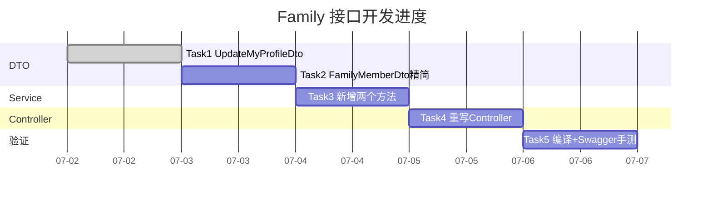

# Family 模块接口 Implementation Plan

> **For agentic workers:** REQUIRED SUB-SKILL: Use superpowers:subagent-driven-development (recommended) or superpowers:executing-plans to implement this plan task-by-task. Steps use checkbox (`- [ ]`) syntax for tracking.

**Goal:** 将 `FamilyController` 从脚手架 CRUD 精简为 2 个业务接口（更新自己资料、获取家庭成员列表），并完成全量 Swagger 标注。

**Architecture:** 复用现有 DAO/Service 基础设施，仅重写 Controller、新增 2 个 Service 方法、补全 DTO 的 Swagger 装饰器。身份与权限依托全局 `JwtAuthGuard`（`req.user` 即 `FamilyMember`）。

**Tech Stack:** NestJS 11、TypeORM、`@nestjs/swagger`、`class-validator`、TypeScript。

## Global Constraints

- 包管理器一律用 `pnpm`（非 npm）。
- Prettier：单引号、尾逗号 `all`。
- 全局 `JwtAuthGuard` 已注册，这两个接口都需要鉴权，**不要**加 `@Public()`。
- 依赖已安装（`@nestjs/swagger` ^11、`class-validator` ^0.15、`class-transformer` ^0.5），**不要**新增任何依赖。
- 不改动实体、DAO、`auth` 模块、`main.ts`。
- `req.user` 由 `JwtStrategy.validate` 注入，为 `FamilyMemberDto`（含 `id`、`groupId`）。
- **Git 前置**：当前仓库处于 detached HEAD（`branch: HEAD`），开发前先 `git switch -c feat/family-api` 建分支，否则 commit 会游离。
- **与 SPEC-003 的一处细化**：`dto/create-family.dto.ts`、`dto/update-family.dto.ts` 虽为空类，但被 `FamilyService.createGroup/updateMember` 等方法用作参数类型（这些方法按 SPEC 保留），故**不删除**，避免连带编译错误。

---

## File Structure

| 文件 | 动作 | 职责 |
|------|------|------|
| `src/modules/family/dto/update-profile.dto.ts` | 新建 | `UpdateMyProfileDto`：更新自己资料的入参 |
| `src/modules/family/dto/family-group.dto.ts` | 修改 | `FamilyMemberDto` 补 `@ApiProperty`、移除 token 字段 |
| `src/modules/family/services/family.service.ts` | 修改 | 同步 `toMemberDto`；新增 `updateMyProfile`、`getGroupMembers` |
| `src/modules/family/family.controller.ts` | 重写 | 删 5 个 Group CRUD，新增 2 接口 + Swagger |

---

## Task 1: 新增 UpdateMyProfileDto

**Files:**
- Create: `src/modules/family/dto/update-profile.dto.ts`

**Interfaces:**
- Produces: `UpdateMyProfileDto`（`{ nickname?: string; avatarUrl?: string }`），供 Task 3 / Task 4 使用。

- [ ] **Step 1: 创建 DTO 文件**

```typescript
// src/modules/family/dto/update-profile.dto.ts
import { ApiProperty } from '@nestjs/swagger';
import { IsOptional, IsString, MaxLength } from 'class-validator';

export class UpdateMyProfileDto {
  @ApiProperty({
    description: '昵称',
    example: '小明妈妈',
    maxLength: 64,
  })
  @IsOptional()
  @IsString()
  @MaxLength(64)
  nickname?: string;

  @ApiProperty({
    description: '头像 URL',
    example: 'https://thirdwx.qlogo.cn/mmopen/xxx/132',
    maxLength: 255,
  })
  @IsOptional()
  @IsString()
  @MaxLength(255)
  avatarUrl?: string;
}
```

- [ ] **Step 2: 验证编译**

Run: `pnpm run build`
Expected: 无错误（独立新文件，不影响现有代码）。

**验收标准:**
- [ ] 文件存在，导出 `UpdateMyProfileDto`
- [ ] `pnpm run build` 通过

---

## Task 2: 精简 FamilyMemberDto 并同步 toMemberDto

移除响应中的 `refreshToken` / `tokenExpiresAt`（敏感字段不下发），并为所有响应属性补 `@ApiProperty`。DTO 定义与 `service.toMemberDto` 强耦合，须同任务改完以保证编译通过。

**Files:**
- Modify: `src/modules/family/dto/family-group.dto.ts`
- Modify: `src/modules/family/services/family.service.ts`（仅 `toMemberDto` 方法）

**Interfaces:**
- Produces: `FamilyMemberDto` 字段集合定为 `{ id, groupId, openId, nickname, avatarUrl, role, joinTime, createdAt, updatedAt }`（无 token 字段），供 Task 3/4 使用。

- [ ] **Step 1: 改写 family-group.dto.ts**

```typescript
// src/modules/family/dto/family-group.dto.ts
import { ApiProperty } from '@nestjs/swagger';
import { MemberLevel } from '../enums/member-level.enum';
import { MemberRole } from '../enums/member-role.enum';

export class FamilyGroupDto {
  @ApiProperty({ description: '家庭组ID' })
  id: string;

  @ApiProperty({ description: '家庭组邀请码（6位）' })
  groupCode: string;

  @ApiProperty({ description: '会员等级', type: Number })
  memberLevel: MemberLevel;

  @ApiProperty({ description: 'VIP过期时间', nullable: true })
  vipExpireTime: Date | null;

  @ApiProperty({ description: '创建时间' })
  createdAt: Date;

  @ApiProperty({ description: '更新时间' })
  updatedAt: Date;
}

export class FamilyMemberDto {
  @ApiProperty({ description: '成员ID' })
  id: string;

  @ApiProperty({ description: '家庭组ID', nullable: true })
  groupId: string | null;

  @ApiProperty({ description: '微信OpenID' })
  openId: string;

  @ApiProperty({ description: '昵称' })
  nickname: string;

  @ApiProperty({ description: '头像URL' })
  avatarUrl: string;

  @ApiProperty({ description: '角色（1=创建者, 2=被邀请者）', type: Number })
  role: MemberRole;

  @ApiProperty({ description: '加入时间' })
  joinTime: Date;

  @ApiProperty({ description: '创建时间' })
  createdAt: Date;

  @ApiProperty({ description: '更新时间' })
  updatedAt: Date;
}
```

- [ ] **Step 2: 同步修改 service.toMemberDto**

在 `src/modules/family/services/family.service.ts` 中，把 `toMemberDto` 改为（删除 `refreshToken`、`tokenExpiresAt` 两行）：

```typescript
  private toMemberDto(entity: FamilyMember): FamilyMemberDto {
    return {
      id: entity.id,
      groupId: entity.groupId,
      openId: entity.openId,
      nickname: entity.nickname,
      avatarUrl: entity.avatarUrl,
      role: entity.role,
      joinTime: entity.joinTime,
      createdAt: entity.createdAt,
      updatedAt: entity.updatedAt,
    };
  }
```

- [ ] **Step 3: 验证编译**

Run: `pnpm run build`
Expected: 无错误（DTO 字段与 `toMemberDto` 赋值一致）。

**验收标准:**
- [ ] `FamilyMemberDto` 不再含 `refreshToken` / `tokenExpiresAt`
- [ ] 所有属性有 `@ApiProperty`
- [ ] `pnpm run build` 通过

---

## Task 3: Service 新增两个方法

**Files:**
- Modify: `src/modules/family/services/family.service.ts`

**Interfaces:**
- Consumes: `UpdateMyProfileDto`（Task 1）、`FamilyMemberDto`（Task 2）、`familyMemberDao.findOne/findByGroupId/update`（已存在）。
- Produces: `updateMyProfile(memberId, dto)`、`getGroupMembers(groupId, currentMemberId)`，供 Task 4 调用。

- [ ] **Step 1: 补充 import**

在 `family.service.ts` 顶部 import 中追加 `ForbiddenException` 与 `UpdateMyProfileDto`：

```typescript
import { Injectable, NotFoundException, ForbiddenException } from '@nestjs/common';
```

```typescript
import { UpdateMyProfileDto } from '../dto/update-profile.dto';
```

- [ ] **Step 2: 新增 updateMyProfile**

在 `FamilyService` 类内（`updateMember` 方法附近）新增：

```typescript
  // 更新当前登录用户的资料（memberId 来自 JWT，杜绝越权）
  async updateMyProfile(
    memberId: string,
    dto: UpdateMyProfileDto,
  ): Promise<FamilyMemberDto> {
    const entity = await this.familyMemberDao.update(memberId, dto);
    if (!entity) {
      throw new NotFoundException(`FamilyMember ${memberId} not found`);
    }
    return this.toMemberDto(entity as FamilyMember);
  }
```

- [ ] **Step 3: 新增 getGroupMembers**

紧接其后新增（先校验调用者为本组成员，再查列表）：

```typescript
  // 获取家庭成员列表（仅本组成员可查）
  async getGroupMembers(
    groupId: string,
    currentMemberId: string,
  ): Promise<FamilyMemberDto[]> {
    const current = await this.familyMemberDao.findOne(currentMemberId);
    if (!current || current.groupId !== groupId) {
      throw new ForbiddenException('无权查看该家庭成员列表');
    }
    const entities = await this.familyMemberDao.findByGroupId(groupId);
    return entities.map((e) => this.toMemberDto(e as FamilyMember));
  }
```

- [ ] **Step 4: 验证编译**

Run: `pnpm run build`
Expected: 无错误。

**验收标准:**
- [ ] 两个方法存在，签名与上述一致
- [ ] `getGroupMembers` 在 `currentMemberId` 不属于该组时抛 `ForbiddenException`
- [ ] `pnpm run build` 通过

---

## Task 4: 重写 Controller

删除 5 个 `FamilyGroup` CRUD，新增 2 个业务接口并完成 Swagger 标注。

**Files:**
- Modify (整文件重写): `src/modules/family/family.controller.ts`

**Interfaces:**
- Consumes: `FamilyService.updateMyProfile/getGroupMembers`（Task 3）、`UpdateMyProfileDto`（Task 1）、`FamilyMemberDto`（Task 2）。

- [ ] **Step 1: 整文件重写为如下内容**

```typescript
// src/modules/family/family.controller.ts
import { Controller, Get, Patch, Body, Param, Req } from '@nestjs/common';
import { ApiTags, ApiOperation, ApiBearerAuth } from '@nestjs/swagger';
import { FamilyService } from './services/family.service';
import { UpdateMyProfileDto } from './dto/update-profile.dto';
import { FamilyMemberDto } from './dto/family-group.dto';

@ApiTags('家庭')
@ApiBearerAuth()
@Controller('family')
export class FamilyController {
  constructor(private readonly familyService: FamilyService) {}

  @Patch('me/profile')
  @ApiOperation({ summary: '更新当前用户的昵称和头像' })
  updateMyProfile(
    @Req() req: any,
    @Body() dto: UpdateMyProfileDto,
  ): Promise<FamilyMemberDto> {
    return this.familyService.updateMyProfile(req.user.id, dto);
  }

  @Get('groups/:groupId/members')
  @ApiOperation({ summary: '获取家庭成员列表（仅本组成员可查）' })
  getGroupMembers(
    @Param('groupId') groupId: string,
    @Req() req: any,
  ): Promise<FamilyMemberDto[]> {
    return this.familyService.getGroupMembers(groupId, req.user.id);
  }
}
```

> 说明：`@ApiBearerAuth()` 置于类级别，两个方法均生效，对应 `main.ts` 已注册的 `bearer` 方案。`@Req() req: any` 与现有 `auth.controller.ts` 风格一致。

- [ ] **Step 2: 验证编译**

Run: `pnpm run build`
Expected: 无错误。原 controller 对 `CreateFamilyDto`/`UpdateFamilyDto`/`PaginateQuery` 的引用已随整文件重写移除。

**验收标准:**
- [ ] controller 仅含 2 个路由方法
- [ ] 类与方法均有 Swagger 装饰器
- [ ] `pnpm run build` 通过

---

## Task 5: 编译 + Swagger 手测验证

**Files:** 无（验证步骤）

- [ ] **Step 1: 全量编译**

Run: `pnpm run build`
Expected: 无错误、无警告。

- [ ] **Step 2: 启动服务**

Run: `pnpm run start:dev`
Expected: 服务正常监听（默认 3000），无启动异常。

- [ ] **Step 3: 核对 Swagger 文档**

浏览器打开 `http://localhost:3000/api-docs`，确认：
- 存在 `家庭` tag
- 该 tag 下**仅有** 2 个接口：`PATCH /family/me/profile`、`GET /family/groups/{groupId}/members`
- 原脚手架的 5 个 Group 接口已消失
- `UpdateMyProfileDto` 的 `nickname`/`avatarUrl` 均有 description、example
- 两个接口右上角有 Bearer 鉴权标记

- [ ] **Step 4（可选，需有效 token）: 接口手测**

1. 用 `wx-openid` header 调 `POST /auth/login` 拿 `accessToken`，在 Swagger 右上角 Authorize 填入。
2. `PATCH /family/me/profile`，body `{ "nickname": "测试昵称" }` → 200，响应**不含** `refreshToken`。
3. `GET /family/groups/{自己的groupId}/members` → 200，返回成员数组。
4. （鉴权失败用例）若构造一个非自身 `groupId` 调用 → 403。

**验收标准:**
- [ ] Swagger 文档符合 Step 3 全部要点
- [ ] （若执行 Step 4）响应体不含 token 字段、越权返回 403

---

## 测试策略

项目业务模块当前无单元测试惯例，本需求沿用 SPEC-003 的验收方式：**TypeScript 编译 + Swagger 文档核对 + 关键路径手测**。验证重点：

1. **类型安全**：每个 Task 末尾 `pnpm run build`，保证 DTO 字段与 `toMemberDto` 赋值一致（最易出错的耦合点）。
2. **鉴权正确性**：`getGroupMembers` 的 `ForbiddenException` 分支是安全核心，Task 5 Step 4 用例 4 覆盖。
3. **文档完整性**：Swagger 是本需求的硬性交付物，Task 5 Step 3 逐项核对。

> 若后续要补单测，建议针对 `FamilyService.getGroupMembers` 写一条「非本组成员 → 抛 ForbiddenException」的用例，价值最高。本次不引入。

---

## 实施进度



> 任务粒度小、强顺序依赖（DTO→Service→Controller→验证），预计 0.5 人天可完成全部编码。

---

## 检查清单（交付前自查）

- [ ] `pnpm run build` 零错误
- [ ] `FamilyController` 仅 2 个路由
- [ ] 所有 DTO 属性有 `@ApiProperty`（含 description）
- [ ] Controller 类与方法有 `@ApiTags` / `@ApiOperation` / `@ApiBearerAuth`
- [ ] `FamilyMemberDto` 响应不含 `refreshToken` / `tokenExpiresAt`
- [ ] `getGroupMembers` 越权返回 403
- [ ] 未改动实体 / DAO / auth 模块
- [ ] 未新增任何依赖
