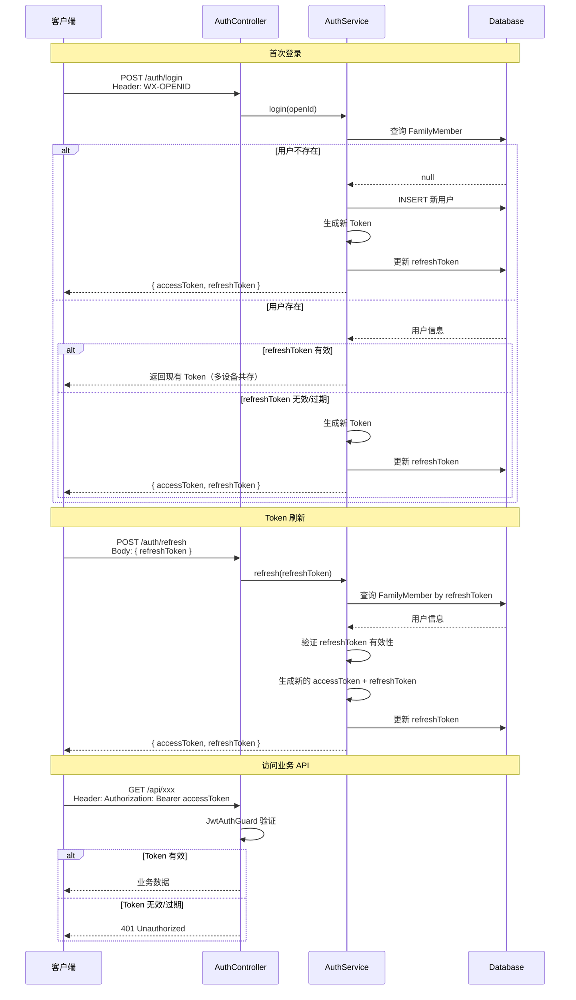

# SPEC-001: JWT 认证与 Swagger 集成

## 需求概述

为 wx-nest 项目添加 JWT 认证系统和 Swagger API 文档支持，用于内部开发团队的接口联调。

## 功能目标

### P0（必须实现）

- [x] JWT 双 Token 认证机制（Access Token + Refresh Token）
- [x] 基于微信 OpenID 的自动登录/注册
- [x] Swagger UI 文档界面（`/api-docs`）
- [x] Swagger Bearer Auth 认证配置
- [x] Token 刷新接口

### P1（重要）

- [x] 多设备共存（同一用户多设备同时登录）
- [x] 环境变量控制 Swagger 开关
- [x] 登出接口（清除 refreshToken）

## 技术方案

### 1. 架构设计

```
┌─────────────────────────────────────────────────────────────────┐
│                         NestJS 应用                              │
├─────────────────────────────────────────────────────────────────┤
│  ┌──────────────┐         ┌─────────────────────────────────┐   │
│  │ Swagger UI   │◄────────│         AuthModule               │   │
│  │  /api-docs   │         │  ┌─────────────────────────────┐ │   │
│  │  (Bearer)    │         │  │ AuthService                │ │   │
│  └──────────────┘         │  │ - login()                  │ │   │
│                           │  │ - refresh()                │ │   │
│                           │  │ - logout()                 │ │   │
│                           │  ├─────────────────────────────┤ │   │
│                           │  │ JwtStrategy                │ │   │
│                           │  │ - validate()               │ │   │
│                           │  ├─────────────────────────────┤ │   │
│                           │  │ JwtAuthGuard               │ │   │
│                           │  │ - canActivate()            │ │   │
│                           │  └─────────────────────────────┘ │   │
│                           └─────────────────────────────────┘   │
│  ┌──────────────────────────────────────────────────────────┐ │
│  │                   FamilyModule                             │ │
│  │         FamilyMember (新增 refreshToken 字段)              │ │
│  └──────────────────────────────────────────────────────────┘ │
└─────────────────────────────────────────────────────────────────┘
```

### 2. 模块结构

```
src/modules/auth/
├── auth.module.ts
├── auth.controller.ts       # POST /auth/login, /auth/refresh, /auth/logout
├── auth.service.ts          # 认证业务逻辑
├── guards/
│   ├── jwt-auth.guard.ts    # JWT 认证守卫
│   ├── jwt.strategy.ts     # Passport JWT 策略
│   └── public.guard.ts     # 公开接口标记（可选）
├── dto/
│   ├── login.dto.ts         # (空 DTO，无需请求体)
│   ├── login-response.dto.ts
│   └── refresh.dto.ts
└── constants.ts              # JWT 配置常量
```

### 3. 数据模型变更

**FamilyMember 实体新增字段**:

```typescript
@Entity('family_member')
export class FamilyMember extends BaseEntity {
  // ... 现有字段

  @Column({ name: 'refresh_token', length: 512, nullable: true })
  refreshToken: string;

  @Column({ name: 'token_expires_at', type: 'datetime', nullable: true })
  tokenExpiresAt: Date;
}
```

### 4. 认证流程



### 5. API 设计

| 路由 | 方法 | 请求 | 响应 | 认证 |
|------|------|------|------|------|
| `/auth/login` | POST | Header: `WX-OPENID` | `{ accessToken, refreshToken }` | 否 |
| `/auth/refresh` | POST | Body: `{ refreshToken }` | `{ accessToken, refreshToken }` | 否 |
| `/auth/logout` | POST | Header: `Authorization: Bearer` | `{ message: '登出成功' }` | 是 |

### 6. DTO 定义

**LoginResponseDto**:
```typescript
export class LoginResponseDto {
  @ApiProperty({ description: '访问令牌' })
  accessToken: string;

  @ApiProperty({ description: '刷新令牌' })
  refreshToken: string;
}
```

**RefreshDto**:
```typescript
export class RefreshDto {
  @ApiProperty({ description: '刷新令牌' })
  @IsString()
  refreshToken: string;
}
```

### 7. Token 配置

| 配置项 | 说明 | 默认值 |
|--------|------|--------|
| JWT_ACCESS_SECRET | Access Token 签名密钥 | (必填) |
| JWT_ACCESS_EXPIRATION | Access Token 有效期 | `15m` |
| JWT_REFRESH_SECRET | Refresh Token 签名密钥 | (可选，与 ACCESS 共用) |
| JWT_REFRESH_EXPIRATION | Refresh Token 有效期 | `7d` |
| SWAGGER_ENABLED | 是否启用 Swagger | `true` |

### 8. Swagger 配置

```typescript
// main.ts
import { SwaggerModule, DocumentBuilder } from '@nestjs/swagger';

async function bootstrap() {
  const app = await NestFactory.create(AppModule);

  // Swagger 配置
  if (process.env.SWAGGER_ENABLED !== 'false') {
    const config = new DocumentBuilder()
      .setTitle('wx-nest API')
      .setDescription('微信教育管理系统 API 文档')
      .setVersion('1.0')
      .addBearerAuth()  // Bearer Auth 认证
      .build();
    const document = SwaggerModule.createDocument(app, config);
    SwaggerModule.setup('api-docs', app, document, {
      swaggerOptions: {
        persistAuthorization: true,  // 持久化认证状态
        tagsSorter: 'alpha',
      },
    });
  }

  await app.listen(process.env.APP_PORT ?? 3000);
}
```

### 9. 依赖包

```json
{
  "dependencies": {
    "@nestjs/jwt": "^10.2.0",
    "@nestjs/passport": "^10.0.0",
    "@nestjs/swagger": "^11.0.0",
    "passport": "^0.7.0",
    "passport-jwt": "^4.0.1"
  }
}
```

## 多设备共存逻辑

**场景**：用户在设备 A 登录，refreshToken 有效期 7 天。第 3 天，用户在设备 B 也登录。

**行为**：
- 如果设备 A 的 refreshToken 仍有效，登录接口返回现有 Token（不更新）
- 如果 refreshToken 已过期，登录接口颁发新 Token

**实现要点**：
```typescript
// 检查 refreshToken 有效性
if (member.refreshToken && member.tokenExpiresAt && member.tokenExpiresAt > new Date()) {
  // 有效：直接返回现有 Token
  return {
    accessToken: this.generateAccessToken(member),
    refreshToken: member.refreshToken,
  };
}
```

## 安全考虑

1. **RefreshToken 存储**: 建议 Hash 后存储到数据库
2. **Token 轮换**: 刷新时同时更新 RefreshToken
3. **HTTPS**: 生产环境强制 HTTPS
4. **Swagger 保护**: 生产环境建议设置 `SWAGGER_ENABLED=false`
5. **JWT Secret**: 必须设置强密钥，不应提交到代码库

## 实施建议

1. **阶段一**：安装依赖，配置 Swagger
2. **阶段二**：实现 Auth 模块基础结构
3. **阶段三**：实现登录/注册逻辑
4. **阶段四**：实现 Token 刷新逻辑
5. **阶段五**：添加 JWT 守卫，保护业务接口
6. **阶段六**：为现有 DTO 添加 Swagger 装饰器

## 风险与应对

| 风险 | 应对措施 |
|------|----------|
| RefreshToken 泄露 | 定期轮换，支持强制登出 |
| Token 无法撤销 | 短期 Access Token + 可撤销的 RefreshToken |
| 多设备冲突 | 采用多设备共存逻辑 |

## 版本历史

| 版本 | 日期 | 变更说明 |
|------|------|----------|
| 1.0 | 2026-07-01 | 初始版本 |
