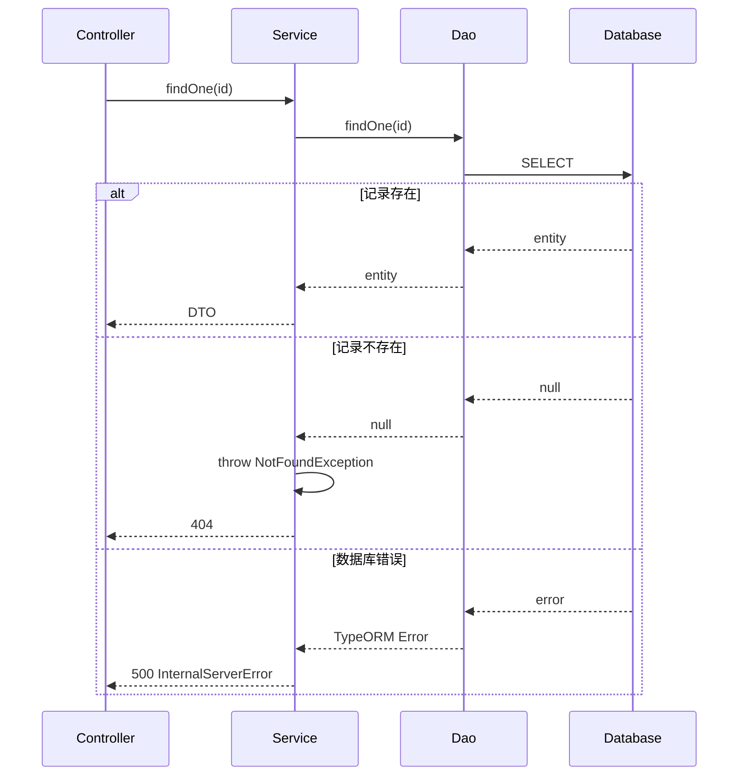

# SPEC-002: DAO 层与 CRUD 架构设计

## 需求概述

为 wx-nest 项目的 7 个实体模块（child, family, course, lesson-log, notification 等）添加完整的 CRUD 功能支持。在模块中增加 dao 目录和相应的 dao 对象，明确 service 和 dao 的职责边界。

## 功能目标

### P0（必须实现）

- [ ] 创建通用 BaseDao 类（位于 `common/dao/`）
- [ ] 为每个实体创建对应的 Dao 类
- [ ] 实现 Service 层与 Dao 层的集成
- [ ] 配置模块依赖注入

### P1（重要）

- [ ] 集成 `nestjs-paginate` 分页库
- [ ] 定义标准错误处理流程
- [ ] 为复杂查询场景预留扩展点

## 技术方案

### 1. 架构设计

```
┌─────────────────────────────────────────────────────────────────┐
│                         NestJS 应用                              │
├─────────────────────────────────────────────────────────────────┤
│  ┌──────────────┐         ┌─────────────────────────────────┐   │
│  │ Controller   │────────▶│         Service                 │   │
│  │ (DTO 验证)   │         │  (业务逻辑 + 异常处理)           │   │
│  └──────────────┘         │  ┌─────────────────────────────┐ │   │
│                           │  │         Dao                 │ │ │
│                           │  │  (数据访问 + TypeORM)        │ │ │
│                           │  │  ┌─────────────────────────┐│ │ │
│                           │  │  │   TypeORM Repository     ││ │ │
│                           │  │  └─────────────────────────┘│ │ │
│                           │  └─────────────────────────────┘ │   │
│                           └─────────────────────────────────┘   │
└─────────────────────────────────────────────────────────────────┘
```

**职责边界：**

| 层级 | 职责 | 异常处理 |
|------|------|----------|
| Controller | DTO 验证、路由 | → |
| Service | 业务逻辑、事务控制 | 捕获 Dao 异常 → 业务异常 |
| Dao | 数据访问、复杂查询 | 抛出技术异常 |

### 2. 目录结构

```
src/
├── common/
│   └── dao/
│       └── base.dao.ts          # 通用 BaseDao 基类
├── modules/
│   ├── child/
│   │   ├── dao/
│   │   │   └── child-account.dao.ts
│   │   ├── dto/
│   │   ├── services/
│   │   │   └── child.service.ts
│   │   ├── child.controller.ts
│   │   ├── child.module.ts
│   │   └── entities/
│   │       └── child-account.entity.ts
│   ├── family/
│   │   ├── dao/
│   │   │   ├── family-group.dao.ts
│   │   │   └── family-member.dao.ts
│   │   ├── services/
│   │   │   └── family.service.ts
│   │   └── ...
│   ├── course/
│   │   ├── dao/
│   │   │   ├── course-package.dao.ts
│   │   │   └── course-time-rule.dao.ts
│   │   └── ...
│   ├── lesson-log/
│   │   ├── dao/
│   │   │   └── class-change-log.dao.ts
│   │   └── ...
│   └── notification/
│       ├── dao/
│       │   └── wechat-subscription.dao.ts
│       └── ...
```

### 3. BaseDao 核心设计

```typescript
// common/dao/base.dao.ts
import { InjectRepository, Type } from '@nestjs/typeorm';
import { Repository, DeepPartial, FindOptionsWhere } from 'typeorm';
import { Injectable } from '@nestjs/common';
import { PaginateQuery, Paginated } from 'nestjs-paginate';

@Injectable()
export abstract class BaseDao<T> {
  constructor(
    @InjectRepository(T) protected readonly repository: Repository<T>,
  ) {}

  // 基础 CRUD
  create(data: DeepPartial<T>): Promise<T> {
    const entity = this.repository.create(data);
    return this.repository.save(entity);
  }

  findOne(id: string): Promise<T | null> {
    return this.repository.findOne({ where: { id } as FindOptionsWhere<T> });
  }

  findMany(filter?: FindOptionsWhere<T>): Promise<T[]> {
    return this.repository.find({ where: filter });
  }

  async update(id: string, data: DeepPartial<T>): Promise<T> {
    await this.repository.update(id, data);
    return this.findOne(id);
  }

  delete(id: string): Promise<void> {
    return this.repository.delete(id).then(() => {});
  }

  // 分页查询（配合 nestjs-paginate）
  paginate(query: PaginateQuery): Promise<Paginated<T>> {
    return paginate(query, this.repository, {
      sortableColumns: ['id', 'createdAt'],
      defaultSortBy: [['id', 'DESC']],
    });
  }
}
```

### 4. 具体 Dao 实现

```typescript
// modules/child/dao/child-account.dao.ts
import { Injectable } from '@nestjs/common';
import { InjectRepository } from '@nestjs/typeorm';
import { Repository } from 'typeorm';
import { ChildAccount } from '../entities/child-account.entity';
import { BaseDao } from '@/common/dao/base.dao';

@Injectable()
export class ChildAccountDao extends BaseDao<ChildAccount> {
  constructor(
    @InjectRepository(ChildAccount)
    repository: Repository<ChildAccount>,
  ) {
    super(repository);
  }

  // 复杂查询方法
  async findByGroupId(groupId: string): Promise<ChildAccount[]> {
    return this.repository.find({
      where: { groupId },
      relations: ['group', 'coursePackages'],
    });
  }

  async findByThemeColor(color: string): Promise<ChildAccount[]> {
    return this.repository.find({ where: { themeColor: color } });
  }
}
```

### 5. Service 层实现

```typescript
// modules/child/services/child.service.ts
import { Injectable, NotFoundException } from '@nestjs/common';
import { ChildAccountDao } from '../dao/child-account.dao';
import { CreateChildDto } from '../dto/create-child.dto';
import { UpdateChildDto } from '../dto/update-child.dto';
import { ChildDto } from '../dto/child.dto';
import { PaginateQuery, Paginated } from 'nestjs-paginate';

@Injectable()
export class ChildService {
  constructor(private readonly childDao: ChildAccountDao) {}

  async create(dto: CreateChildDto): Promise<ChildDto> {
    const entity = await this.childDao.create(dto);
    return this.toDto(entity);
  }

  async findAll(query: PaginateQuery): Promise<Paginated<ChildDto>> {
    return await this.childDao.paginate(query);
  }

  async findOne(id: string): Promise<ChildDto> {
    const entity = await this.childDao.findOne(id);
    if (!entity) {
      throw new NotFoundException(`Child ${id} not found`);
    }
    return this.toDto(entity);
  }

  async update(id: string, dto: UpdateChildDto): Promise<ChildDto> {
    const entity = await this.childDao.update(id, dto);
    if (!entity) {
      throw new NotFoundException(`Child ${id} not found`);
    }
    return this.toDto(entity);
  }

  async remove(id: string): Promise<void> {
    const entity = await this.childDao.findOne(id);
    if (!entity) {
      throw new NotFoundException(`Child ${id} not found`);
    }
    await this.childDao.delete(id);
  }

  private toDto(entity: ChildAccount): ChildDto {
    // 实体到 DTO 的转换逻辑
    return {
      id: entity.id,
      groupId: entity.groupId,
      childName: entity.childName,
      themeColor: entity.themeColor,
      createdAt: entity.createdAt,
      updatedAt: entity.updatedAt,
    };
  }
}
```

### 6. 模块配置

```typescript
// modules/child/child.module.ts
import { Module } from '@nestjs/common';
import { TypeOrmModule } from '@nestjs/typeorm';
import { ChildAccount } from './entities/child-account.entity';
import { ChildAccountDao } from './dao/child-account.dao';
import { ChildService } from './services/child.service';
import { ChildController } from './child.controller';

@Module({
  imports: [TypeOrmModule.forFeature([ChildAccount])],
  providers: [
    ChildAccountDao,
    ChildService,
  ],
  controllers: [ChildController],
  exports: [ChildService],
})
export class ChildModule {}
```

### 7. 错误处理流程



**异常映射表：**

| 场景 | Dao 异常 | Service 处理 | HTTP 状态 |
|------|----------|-------------|----------|
| 记录不存在 | 返回 null | NotFoundException | 404 |
| 约束违反 | TypeORM Error | BadRequestException | 400 |
| 连接失败 | TypeORM Error | InternalServerErrorException | 500 |
| 参数无效 | - | ValidationPipe | 400 |

### 8. 分页集成

**安装依赖：**
```bash
pnpm add nestjs-paginate
```

**分页查询示例：**
```
GET /child?page=1&limit=10&sortBy=createdAt:desc
```

**响应格式：**
```json
{
  "data": [...],
  "meta": {
    "total": 100,
    "currentPage": 1,
    "perPage": 10,
    "lastPage": 10
  }
}
```

### 9. 依赖包

```json
{
  "dependencies": {
    "nestjs-paginate": "^1.0.0"
  }
}
```

## 涉及实体列表

| 模块 | 实体 | Dao 类 |
|------|------|--------|
| child | ChildAccount | ChildAccountDao |
| family | FamilyGroup | FamilyGroupDao |
| family | FamilyMember | FamilyMemberDao |
| course | CoursePackage | CoursePackageDao |
| course | CourseTimeRule | CourseTimeRuleDao |
| lesson-log | ClassChangeLog | ClassChangeLogDao |
| notification | WechatSubscription | WechatSubscriptionDao |

## 实施建议

### 阶段一：基础设施
1. 安装 `nestjs-paginate` 依赖
2. 创建 `common/dao/base.dao.ts`
3. 为一个模块创建示例 Dao（建议从 child 模块开始）

### 阶段二：模块实现
1. 为每个模块创建对应的 Dao 类
2. 更新 Service 层注入和使用 Dao
3. 更新模块配置（注册 Dao 作为 provider）

### 阶段三：验证测试
1. 验证 CRUD 功能
2. 验证分页功能
3. 验证异常处理

### 阶段四：复杂查询（可选）
1. 根据业务需求添加关联查询方法
2. 添加条件筛选方法

## 设计原则

1. **单一职责**：Dao 只负责数据访问，Service 只负责业务逻辑
2. **依赖倒置**：Service 依赖抽象的 Dao 接口（而非具体实现）
3. **开闭原则**：BaseDao 封装通用行为，子类扩展特殊行为
4. **YAGNI**：不提前实现暂时不需要的查询方法

## 风险与应对

| 风险 | 应对措施 |
|------|----------|
| 模块间循环依赖 | 明确 exports/imports，避免跨模块直接注入 Dao |
| 复杂查询性能瓶颈 | 后续可添加 QueryBuilder 方法或原生 SQL |
| 分页大数据量 | nestjs-paginate 基于 LIMIT/OFFSET，超大数据可考虑游标分页 |

## 版本历史

| 版本 | 日期 | 变更说明 |
|------|------|----------|
| 1.0 | 2026-07-02 | 初始版本 |
