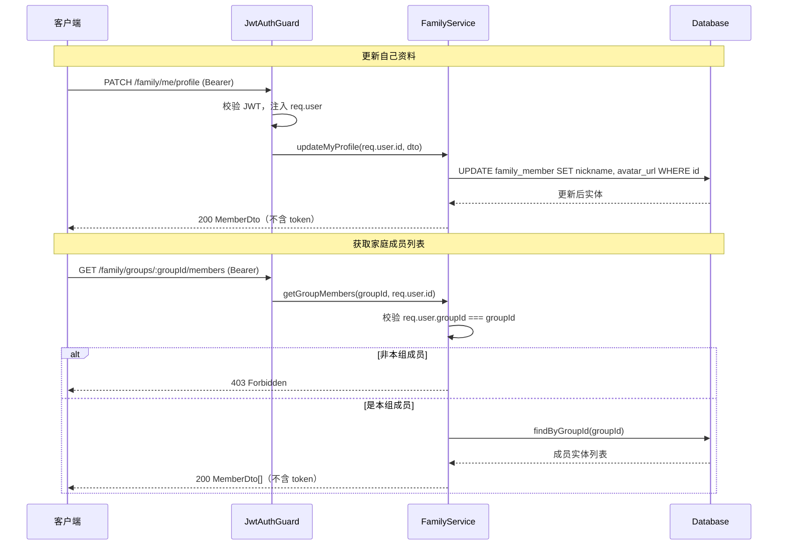

# SPEC-003: Family 模块接口设计

## 需求概述

梳理并精简 Family 模块对外暴露的 HTTP 接口：移除脚手架生成的家庭组 CRUD，仅保留两个业务真正需要的接口——**更新当前登录用户的 nickname/avatar_url**、**根据家庭分组 id 获取成员列表**。所有接口与 DTO 必须标注 Swagger 说明。

## 功能目标

### P0（必须实现）

- [ ] 移除现有 `FamilyController` 中 5 个 `FamilyGroup` CRUD 接口（create/findAll/findOne/update/remove）
- [ ] 新增 `PATCH /family/me/profile` —— 更新自己的 nickname、avatarUrl
- [ ] 新增 `GET /family/groups/:groupId/members` —— 获取家庭成员列表
- [ ] 所有 Controller 方法标注 `@ApiTags` / `@ApiOperation` / `@ApiBearerAuth`
- [ ] 所有 DTO 属性标注 `@ApiProperty` 并加 `class-validator` 校验
- [ ] 成员列表仅本组成员可查（403 拦截非成员）
- [ ] 成员列表响应不下发敏感字段（refreshToken / tokenExpiresAt）

### P1（约束）

- [ ] 不改动实体、DAO、auth 模块
- [ ] Service 既有方法全部保留（被 `JwtStrategy`、`AuthService` 依赖），仅 controller 层精简

## 背景与现状

- **全局鉴权**：`AppModule` 注册 `JwtAuthGuard` 为 `APP_GUARD`，所有接口默认需 JWT；`@Public()` 标记的接口除外。
- **当前用户**：`JwtStrategy.validate` 返回 `FamilyMemberDto`，故 `req.user.id` 即当前成员 memberId，`req.user.groupId` 即其所属家庭组。
- **可复用**：`FamilyMemberDao.findByGroupId()`、`FamilyMemberDao.update()`、`BaseDao` 均已就绪。
- **现状问题**：`FamilyController` 是 `nest g resource` 生成的默认 CRUD，全部针对 `FamilyGroup`，无 Swagger 装饰器，且与实际业务不符。

## 技术方案

### 1. 接口清单

| 方法 | 路由 | 说明 | 入参 | 鉴权 |
|------|------|------|------|------|
| `PATCH` | `/family/me/profile` | 更新自己的 nickname、avatarUrl | Body: `UpdateMyProfileDto` | JWT（必填） |
| `GET` | `/family/groups/:groupId/members` | 获取家庭成员列表 | Path: `groupId` | JWT + 本组成员校验 |

### 2. 请求流程



### 3. DTO 设计

**UpdateMyProfileDto**（更新自己的资料，两字段均可选）

```typescript
export class UpdateMyProfileDto {
  @ApiProperty({ description: '昵称', example: '小明妈妈', maxLength: 64 })
  @IsOptional()
  @IsString()
  @MaxLength(64)
  nickname?: string;

  @ApiProperty({ description: '头像 URL', example: 'https://xxx/avatar.png', maxLength: 255 })
  @IsOptional()
  @IsString()
  @MaxLength(255)
  avatarUrl?: string;
}
```

**FamilyMemberDto（响应，精简版）**

移除 `refreshToken`、`tokenExpiresAt`，其余字段（id、groupId、openId、nickname、avatarUrl、role、joinTime、createdAt、updatedAt）保留并标注 `@ApiProperty`。

### 4. Service 新增方法

```typescript
// 更新自己的资料（memberId 来自 JWT，杜绝越权）
async updateMyProfile(memberId: string, dto: UpdateMyProfileDto): Promise<FamilyMemberDto>;

// 获取家庭成员列表（校验调用者为本组成员）
async getGroupMembers(groupId: string, currentMemberId: string): Promise<FamilyMemberDto[]>;
```

`getGroupMembers` 内部：取 `req.user.groupId` 与入参 `groupId` 比对，不等抛 `ForbiddenException`；相等则复用 `familyMemberDao.findByGroupId()` 并转精简 DTO。

### 5. 改动范围（最小化）

| 文件 | 改动 |
|------|------|
| `family.controller.ts` | 重写：删除 5 个 Group CRUD，新增 2 个接口 + Swagger 装饰器 |
| `services/family.service.ts` | 新增 `updateMyProfile`、`getGroupMembers` 两个方法；既有方法保留 |
| `dto/update-profile.dto.ts`（新增） | 定义 `UpdateMyProfileDto`（含 `@ApiProperty` + 校验） |
| `dto/create-family.dto.ts`、`update-family.dto.ts` | 脚手架遗留空类，删除 |
| `dto/family-group.dto.ts` | `FamilyMemberDto` 补 `@ApiProperty`，移除敏感字段映射 |

**不改动**：实体、DAO、`auth` 模块、`main.ts`（Swagger 已配置）。

## 权限与安全

1. **更新自己**：memberId 一律从 `req.user.id` 取，路径/body 不接收 id，从根上杜绝越权改他人资料。
2. **成员列表**：强制 `req.user.groupId === groupId`，防止枚举 `groupId` 窥探他人家庭成员。
3. **敏感字段**：响应 DTO 不下发 `refreshToken` / `tokenExpiresAt`。
4. **输入校验**：`nickname` / `avatarUrl` 加长度上限，与实体列定义一致。

## 风险与应对

| 风险 | 应对 |
|------|------|
| 移除 Group CRUD 后，外部若有调用方依赖会断裂 | 当前无前端/调用方依赖，属脚手架遗留代码，安全移除 |
| `req.user` 数据可能滞后（用户刚换组） | `JwtStrategy.validate` 每次请求都查库取最新 member，无缓存脏读风险 |
| 成员列表响应过大 | 家庭组成员数天然有限（通常 < 10），无需分页 |

## 实施建议

1. **步骤一**：重写 `family.controller.ts` 为 2 个接口（含 Swagger 装饰器）
2. **步骤二**：在 `family.service.ts` 新增 `updateMyProfile`、`getGroupMembers`
3. **步骤三**：新增/更新 DTO（`@ApiProperty` + `class-validator`）
4. **步骤四**：`pnpm run build` 编译通过，`/api-docs` 验证文档

## 版本历史

| 版本 | 日期 | 变更说明 |
|------|------|----------|
| 1.0 | 2026-07-02 | 初始版本 |
