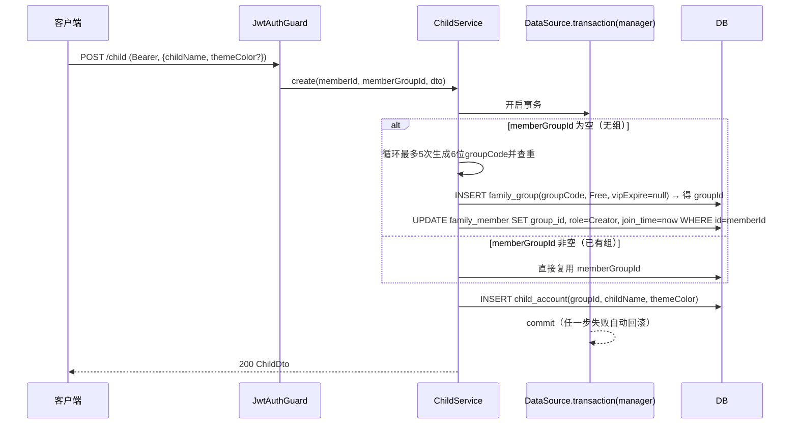

# SPEC-004: Child 模块接口设计

## 需求概述

完成 child 模块的孩子账户管理接口。核心是「创建孩子」时自动处理家庭组归属：当前登录 member 若无家庭组，则**在同一事务内**创建家庭组并绑定 member，再创建孩子；若已有家庭组，则复用该组直接创建孩子。此外提供：查询当前家庭组的孩子列表、修改孩子属性、软删除孩子。所有接口与 DTO 必须标注 Swagger 说明。

## 功能目标

### P0（必须实现）

- [ ] `POST /child` —— 创建孩子。member 无组则事务内建组+绑定 member（role=创建者）+建孩子；有组则复用组直接建孩子。
- [ ] `GET /child` —— 查询当前 member 家庭组下的孩子列表（按 `req.user.groupId` 查）。
- [ ] `PATCH /child/:id` —— 修改孩子属性（仅 `childName` / `themeColor`）。
- [ ] `DELETE /child/:id` —— 软删除孩子（`@DeleteDateColumn`）。
- [ ] 移除脚手架的 `findAll`(分页全量) 与 `findOne`(按 id 查单个) 路由。
- [ ] 所有 Controller 方法标注 `@ApiTags` / `@ApiOperation` / `@ApiBearerAuth`。
- [ ] 所有 DTO 属性标注 `@ApiProperty` 并加 `class-validator` 校验。
- [ ] 创建/修改/删除接口做越权防护：仅本组成员可操作本组孩子（非本组 → 403）。

### P1（约束）

- [ ] 不改动 `FamilyService`、`FamilyModule`、`FamilyGroupDao`、`auth` 模块。
- [ ] 不新增任何依赖（`@nestjs/swagger`、`class-validator`、`class-transformer`、`typeorm`、`nestjs-paginate` 均已存在）。
- [ ] 软删除能力下沉到 `BaseDao`（新增 `softDelete`），不覆写子类 `delete`。
- [ ] `group_code` 在数据库层有唯一约束保证不重复（已存在），应用层再做预查重。

## 背景与现状

- **全局鉴权**：`AppModule` 注册 `JwtAuthGuard` 为 `APP_GUARD`；`@Public()` 之外的接口默认需 JWT。
- **当前用户**：`JwtStrategy.validate` 每次请求查库返回 `FamilyMemberDto`，故 `req.user.id` = memberId，`req.user.groupId` = 其所属家庭组（可能为 `null`）。
- **ER 关系**：`child_account` 通过 `group_id` 挂在 `family_group` 下（不直接挂 member，多成员共享账本）；`child_account` 被 `course_package`(1:N) 引用，课包下还有排课规则与消课流水。
- **child 模块现状**：`nest g resource` 生成的 5 个脚手架 CRUD，无 Swagger、无鉴权感知；`CreateChildDto` 为空类；`ChildAccountDao.findByGroupId(groupId)` 已存在（列表查询复用）；`ChildModule` 仅 `forFeature([ChildAccount])`。
- **可复用**：`FamilyGroup.group_code` 已有 `@Index({ unique: true })`（DB 层唯一约束已就绪）；`BaseDao` 提供 `create/findOne/findMany/update/delete/paginate`。
- **`BaseDao.delete` 当前是硬删**（`repository.delete`），TypeORM 的软删仅在 `softDelete()` 触发，故需在基类补 `softDelete`。

## 技术方案

### 1. 接口清单

| 方法 | 路由 | 说明 | 入参 | 鉴权 |
|------|------|------|------|------|
| `POST` | `/child` | 创建孩子（member 无组则自动建组+绑定，有组则复用） | Body: `CreateChildDto` | JWT |
| `GET` | `/child` | 查询当前 member 家庭组的孩子列表 | — | JWT（仅本组） |
| `PATCH` | `/child/:id` | 修改孩子属性 | Body: `UpdateChildDto` | JWT（越权 403） |
| `DELETE` | `/child/:id` | 软删除孩子 | — | JWT（越权 403） |

### 2. 创建流程（核心，单事务）



事务实现：`DataSource.transaction(async (manager) => {...})`（TypeORM 原生，零新依赖）。事务内通过 `manager.create / manager.save / manager.update` 直接操作 `FamilyGroup` / `FamilyMember` / `ChildAccount` 三张表，**不调用 `FamilyService` / `FamilyGroupDao`**（它们无事务感知，且本需求不让其接受 manager 参数，避免扩散事务复杂度）。

`DataSource` 由 `TypeOrmModule.forRoot` 全局提供，`ChildService` 直接构造注入即可，`ChildModule.imports` 无需改动。

### 3. groupCode 生成（DB 硬保证 + 应用层预查重）

- **DB 层**：`family_group.group_code` 的 `@Index({ unique: true })` 是最终防线，物理上不可能出现重复（并发冲突时 DB 抛唯一约束异常，事务回滚）。
- **应用层**：`ChildService` 私有方法 `randomGroupCode()` 生成 6 位随机串（字符集 `0-9A-Z` 去除易混淆字符 `O/0/I/1/L`）。事务内循环最多 5 次：生成 → `manager.findOne(FamilyGroup, { where: { groupCode } })` 查重 → 不存在则采用。
- **兜底**：5 次仍冲突（极低概率）抛 `ConflictException('家庭码生成失败，请重试')`；或并发下 insert 触发 DB 唯一约束异常 → 事务回滚 → 接口返回 409 由前端重试。

### 4. 软删除

- `child_account` 新增 `@DeleteDateColumn({ name: 'deleted_at', type: 'datetime', nullable: true }) deletedAt: Date | null`。
- `BaseDao` 新增 `softDelete(id: string): Promise<void>`，内部 `this.repository.softDelete(id)`。原 `delete()` 硬删保留。
- `@DeleteDateColumn` 使 `find / findOne / findMany / findByGroupId` **自动过滤** `deleted_at IS NULL`，查询代码无需改动。
- `ChildService.remove` 改为调用 `childDao.softDelete(id)`。

### 5. DTO 设计

**CreateChildDto**（`childName` 必填，`themeColor` 可选带默认值，不含 `groupId`）

```typescript
export class CreateChildDto {
  @ApiProperty({ description: '孩子称呼', example: '小明', maxLength: 64 })
  @IsNotEmpty()
  @IsString()
  @MaxLength(64)
  childName: string;

  @ApiProperty({
    description: '主题色（Hex），不传则用默认色',
    example: '#FFB400',
    maxLength: 20,
    required: false,
  })
  @IsOptional()
  @IsString()
  @MaxLength(20)
  themeColor?: string;
}
```

**UpdateChildDto**（`PartialType(CreateChildDto)`，即 `childName?` / `themeColor?`，`groupId` 永不可改）

```typescript
export class UpdateChildDto extends PartialType(CreateChildDto) {}
```

**ChildDto**（响应，补 `@ApiProperty`）

```typescript
export class ChildDto {
  @ApiProperty({ description: '孩子ID' })
  id: string;

  @ApiProperty({ description: '所属家庭组ID' })
  groupId: string;

  @ApiProperty({ description: '孩子称呼' })
  childName: string;

  @ApiProperty({ description: '主题色' })
  themeColor: string;

  @ApiProperty({ description: '创建时间' })
  createdAt: Date;

  @ApiProperty({ description: '更新时间' })
  updatedAt: Date;
}
```

### 6. Service 方法签名

```typescript
// 创建孩子（memberId/memberGroupId 来自 req.user；无组时建组+绑定member）
async create(
  memberId: string,
  memberGroupId: string | null,
  dto: CreateChildDto,
): Promise<ChildDto>;

// 查询当前家庭组孩子列表（groupId 为 null 时返回空数组）
async findMyChildren(memberGroupId: string | null): Promise<ChildDto[]>;

// 修改孩子（校验 child.groupId === memberGroupId，否则 403）
async update(
  memberGroupId: string,
  childId: string,
  dto: UpdateChildDto,
): Promise<ChildDto>;

// 软删除孩子（校验 child.groupId === memberGroupId，否则 403）
async remove(memberGroupId: string, childId: string): Promise<void>;
```

`themeColor` 默认值在 `create` 内兜底：`const themeColor = dto.themeColor ?? '#FFB400'`。

### 7. Controller 草案

```typescript
@ApiTags('孩子')
@ApiBearerAuth()
@Controller('child')
export class ChildController {
  constructor(private readonly childService: ChildService) {}

  @Post()
  @ApiOperation({ summary: '创建孩子（无家庭组则自动建组）' })
  create(@Req() req: any, @Body() dto: CreateChildDto): Promise<ChildDto> {
    return this.childService.create(req.user.id, req.user.groupId, dto);
  }

  @Get()
  @ApiOperation({ summary: '查询当前家庭组的孩子列表' })
  findMyChildren(@Req() req: any): Promise<ChildDto[]> {
    return this.childService.findMyChildren(req.user.groupId);
  }

  @Patch(':id')
  @ApiOperation({ summary: '修改孩子属性' })
  update(
    @Param('id') id: string,
    @Req() req: any,
    @Body() dto: UpdateChildDto,
  ): Promise<ChildDto> {
    return this.childService.update(req.user.groupId, id, dto);
  }

  @Delete(':id')
  @ApiOperation({ summary: '删除孩子（软删除）' })
  remove(@Param('id') id: string, @Req() req: any): Promise<void> {
    return this.childService.remove(req.user.groupId, id);
  }
}
```

### 8. 改动范围（最小化）

| 文件 | 动作 | 改动 |
|------|------|------|
| `src/common/dao/base.dao.ts` | 修改 | 新增 `softDelete(id: string): Promise<void>` |
| `src/modules/child/entities/child-account.entity.ts` | 修改 | 新增 `@DeleteDateColumn deletedAt` |
| `src/modules/child/dto/create-child.dto.ts` | 重写 | `childName`(必填) + `themeColor`(可选) + 装饰器与校验 |
| `src/modules/child/dto/update-child.dto.ts` | 保留 | `PartialType(CreateChildDto)`（已是，仅需确认 import 正确） |
| `src/modules/child/dto/child.dto.ts` | 修改 | 补 `@ApiProperty` |
| `src/modules/child/services/child.service.ts` | 重写 | 事务化 `create`、`findMyChildren`、`update`(越权)、`remove`(softDelete+越权)；私有 `randomGroupCode`；移除 `findAll`/`findOne` 脚手架 |
| `src/modules/child/child.controller.ts` | 重写 | 4 个业务接口 + Swagger 装饰器 |
| `src/modules/child/child.module.ts` | 不改 | `forFeature([ChildAccount])` 已够；`DataSource` 全局可用 |
| `src/modules/child/dao/child-account.dao.ts` | 不改 | 继承 `softDelete`；`findByGroupId` 因 `@DeleteDateColumn` 自动过滤已删 |

**不改动**：`FamilyService`、`FamilyModule`、`FamilyGroupDao`、`FamilyMemberDao`、`auth` 模块、`main.ts`、其他模块实体。

## 权限与安全

1. **创建**：`groupId` 一律来自 `req.user`（无组则在事务内新建并绑定），客户端无法指定他人组。
2. **列表**：强制按 `req.user.groupId` 查询；`groupId` 为 `null`（未建组）时返回空数组而非报错。
3. **改/删**：先查 child，校验 `child.groupId === req.user.groupId`，不等抛 `ForbiddenException`（403）；child 不存在或已被软删统一抛 `NotFoundException`（404），不泄露存在性。
4. **输入校验**：`childName` 必填且 ≤64；`themeColor` 可选且 ≤20，与实体列长度一致。
5. **事务原子性**：建组+绑 member+建孩子三步在单个 `DataSource.transaction` 内，失败整体回滚，杜绝「建了组却没绑上」的脏数据。

## 风险与应对

| 风险 | 应对 |
|------|------|
| 三步操作非原子导致脏数据 | 单个 `DataSource.transaction` 包裹，失败自动回滚 |
| `groupCode` 并发冲突 | DB `unique index` 硬保证 + 应用层预查重重试 5 次；冲突时事务回滚返回 409 |
| 软删孩子后无法恢复 | 本需求不做（YAGNI）；`@DeleteDateColumn` 保留数据，将来需要可加恢复接口 |
| 跨模块写 `family_group`/`family_member` 略越边界 | TypeORM 跨表事务必须在单 manager 下操作，无法委派给无事务感知的 `FamilyService`；当前建组唯一入口是创建孩子，内聚于 `ChildService` 合理 |
| member 已是某组「被邀请人」后又触发建组 | 不会发生：建组分支仅在 `memberGroupId === null` 进入；已有组的 member 走复用分支 |
| `themeColor` 未传导致 NOT NULL 插入失败 | service 内 `?? '#FFB400'` 兜底默认值 |

## 实施建议

1. **步骤一**：`BaseDao` 加 `softDelete`；`ChildAccount` 实体加 `@DeleteDateColumn`。
2. **步骤二**：重写 `CreateChildDto` / `ChildDto`（装饰器 + 校验）。
3. **步骤三**：重写 `ChildService`（事务化 `create` 含 groupCode 生成、`findMyChildren`、带越权校验的 `update`/`remove`）。
4. **步骤四**：重写 `ChildController`（4 接口 + Swagger）。
5. **步骤五**：`pnpm run build` + `/api-docs` 核对 + 关键路径手测（建组事务、越权 403、软删后列表不可见）。

## 依赖前置

- 本 SPEC 假设 `req.user` 为含 `id` / `groupId` 的 `FamilyMemberDto`。若 SPEC-003（family 接口）尚未实现，不影响本 SPEC——`JwtStrategy.validate` 当前已返回 `FamilyMemberDto`（含 `groupId`），可直接使用。

## 版本历史

| 版本 | 日期 | 变更说明 |
|------|------|----------|
| 1.0 | 2026-07-02 | 初始版本 |
