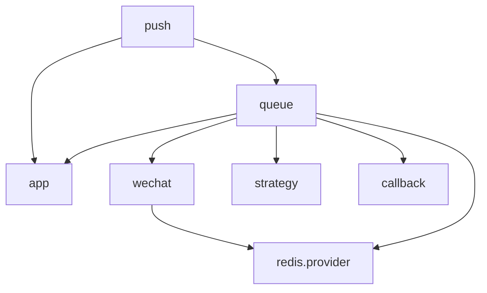
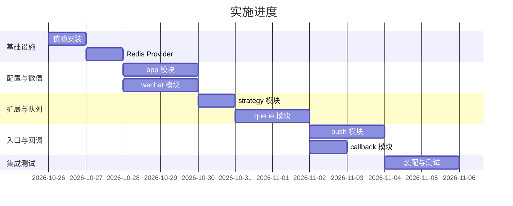

# 微信订阅消息推送服务 实施计划

- 日期: 2026-10-26
- 状态: 已实现
- 关联: [docs/proposals/2026-10-25-generic-wechat-subscribe-push.md](../proposals/2026-10-25-generic-wechat-subscribe-push.md)

## 1. 概述

基于已定稿方案，将 `src/` 从推送服务骨架实现为可运行的微信订阅消息推送服务。核心链路：

```
POST /push/send → DTO 校验 + requestId 幂等 → BullMQ 入队 → Worker → 策略路由/组装 → 微信 send → 结果分类 → fire-and-forget 回调
```

### 技术栈（新增依赖）

| 包 | 用途 |
|----|------|
| `@nestjs/bullmq` | NestJS 集成 BullMQ（Queue/Worker/QueueEvents） |
| `bullmq` | 队列核心 |
| `ioredis` | Redis 客户端（BullMQ 连接 + token 共享缓存） |
| `js-yaml` | 解析静态账户配置 `config/apps.yaml` |

### 目标文件结构

```
src/
├── main.ts / app.module.ts / app.controller.ts / app.service.ts   # 已就绪（骨架）
├── config/
│   └── config.module.ts                                           # 已就绪
├── app/                    # 多小程序配置与隔离
│   ├── app.module.ts
│   ├── app-config.interface.ts
│   ├── app-config.loader.ts
│   └── app.registry.ts
├── wechat/                 # access_token 与订阅消息发送
│   ├── wechat.module.ts
│   ├── wechat.service.ts
│   ├── wechat.client.ts
│   └── token.cache.ts
├── strategy/               # 强策略扩展
│   ├── strategy.module.ts
│   ├── push-strategy.interface.ts
│   ├── strategy.registry.ts
│   └── strategies/         # 按小程序 appId 分目录
│       └── <appId>/*.strategy.ts
├── queue/                  # BullMQ 装配
│   ├── queue.module.ts
│   ├── redis.provider.ts
│   └── push.processor.ts
├── push/                   # HTTP 入口
│   ├── push.module.ts
│   ├── push.controller.ts
│   ├── push.service.ts
│   └── dto/push-subscribe.dto.ts
└── callback/               # fire-and-forget 回调
    ├── callback.module.ts
    └── callback.service.ts
```

`config/apps.yaml`（仓库根，账户/模板/回调静态配置）。

### 模块依赖关系



## 2. 阶段与任务

### 阶段 0：依赖与 Redis 基础设施

#### 任务 0.1：安装新依赖

**文件**:
- 修改: `package.json`、`pnpm-lock.yaml`

**步骤**:

**步骤 1: 安装运行时依赖**

```bash
pnpm add @nestjs/bullmq bullmq ioredis js-yaml
pnpm add -D @types/js-yaml
```

**验收标准**:
- [ ] `package.json` 依赖区含上述 4 个运行时包，dev 区含 `@types/js-yaml`
- [ ] `pnpm install` 成功，lockfile 同步

#### 任务 0.2：Redis 连接 Provider

**文件**:
- 创建: `src/queue/redis.provider.ts`

**步骤**:

**步骤 1: 提供共享 ioredis 实例**

- 定义常量 `REDIS_CONNECTION = 'REDIS_CONNECTION'`
- Provider `useFactory` 创建 `new Redis({ host, port, password, maxRetriesPerRequest: null })`，参数来自 `ConfigService`（`REDIS_HOST`/`REDIS_PORT`/`REDIS_PASSWORD`）
- 该实例同时供 BullMQ 与 token 缓存复用

**验收标准**:
- [ ] 单例 ioredis 连接，`maxRetriesPerRequest: null`（BullMQ 必需）
- [ ] 环境变量缺失时有默认值（host=localhost, port=6379）

### 阶段 1：app 模块（多小程序配置）

#### 任务 1.1：配置接口

**文件**:
- 创建: `src/app/app-config.interface.ts`

**步骤**:

**步骤 1: 定义类型**

```ts
export interface CallbackConfig {
  url: string;
}
export interface TemplateConfig {
  templateId: string;
  fields?: string[]; // 可选字段 schema
}
export interface AppConfig {
  appId: string;
  name: string;
  secret: string;
  callback?: CallbackConfig;
  templates?: TemplateConfig[];
}
```

**验收标准**:
- [ ] 类型覆盖账户/模板/回调三要素

#### 任务 1.2：配置加载器

**文件**:
- 创建: `src/app/app-config.loader.ts`
- 创建: `config/apps.yaml`

**步骤**:

**步骤 1: 读取并解析 YAML**

- `loadAppConfigs(): AppConfig[]`，`readFileSync('config/apps.yaml')` + `js-yaml` 解析
- 路径用 `process.cwd()` 解析，避免相对路径漂移

**步骤 2: 提供示例配置**

`config/apps.yaml`：

```yaml
apps:
  - appId: wx123
    name: 示例小程序
    secret: <appsecret>
    callback:
      url: https://partner.example.com/notify/callback
    templates:
      - templateId: tpl_demo
        fields: [thing1, time2]
```

**验收标准**:
- [ ] 解析失败（文件缺失/格式错误）时抛明确错误并在启动期暴露

#### 任务 1.3：AppRegistry

**文件**:
- 创建: `src/app/app.registry.ts`

**步骤**:

**步骤 1: 构建并查询**

- 构造时调用 `loadAppConfigs()`，建 `Map<appId, AppConfig>`
- `get(appId): AppConfig | undefined`
- `resolveCallbackUrl(appId, requestCallbackUrl?): string | undefined`（`requestCallbackUrl ?? appConfig.callback?.url`）

**验收标准**:
- [ ] `get` 未命中返回 undefined（上层据此报 400/404）

#### 任务 1.4：app.module

**文件**:
- 创建: `src/app/app.module.ts`

**步骤**:

**步骤 1: 导出 AppRegistry**

- `providers: [AppRegistry]`，`exports: [AppRegistry]`

**验收标准**:
- [ ] 其他模块可 `imports: [AppModule]` 注入 `AppRegistry`

### 阶段 2：wechat 模块（token 与发送）

#### 任务 2.1：token 缓存

**文件**:
- 创建: `src/wechat/token.cache.ts`

**步骤**:

**步骤 1: Redis 缓存 access_token**

- key：`wechat:token:{appId}`
- `get(appId): Promise<string | null>`
- `set(appId, token, expiresInSec)`，TTL = `expiresInSec - 300`（留 5 分钟缓冲）
- 依赖 `REDIS_CONNECTION` 注入

**验收标准**:
- [ ] 按 appid 隔离，绝不串用

#### 任务 2.2：wechat client

**文件**:
- 创建: `src/wechat/wechat.client.ts`

**步骤**:

**步骤 1: 封装微信 HTTP 调用（Node 内置 fetch）**

- `fetchAccessToken(appId, secret)` → `GET /cgi-bin/token`
- `sendSubscribeMessage(accessToken, payload)` → `POST /cgi-bin/message/subscribe/send`
- 返回 `{ errcode, errmsg }`，非 200/网络错误抛出

**验收标准**:
- [ ] 纯 HTTP 封装，无业务逻辑，便于 mock 测试

#### 任务 2.3：wechat service

**文件**:
- 创建: `src/wechat/wechat.service.ts`

**步骤**:

**步骤 1: 组装发送与错误分类**

- `getAccessToken(appId)`: 缓存命中直接用；未命中 → `fetchAccessToken` → 写缓存
- `sendSubscribeMessage(appId, payload)`: 取 token → send；`errCode 40001` 时失效缓存并刷新 token 重试一次
- 导出错误分类：`TRANSIENT`（40001/45009）、`TERMINAL`（43101/40003/47003/其余）

**验收标准**:
- [ ] 40001 自动刷新 token 重试一次
- [ ] 43101 标记为 terminal 且不重试

#### 任务 2.4：wechat.module

**文件**:
- 创建: `src/wechat/wechat.module.ts`

**步骤**:

**步骤 1: 组装导出**

- `providers: [TokenCache, WechatClient, WechatService]`，`exports: [WechatService]`
- `imports` 引入提供 `REDIS_CONNECTION` 的模块（queue 的 redis provider 所在模块）

**验收标准**:
- [ ] `WechatService` 可被 queue 模块注入

### 阶段 3：strategy 模块（强策略）

#### 任务 3.1：策略接口

**文件**:
- 创建: `src/strategy/push-strategy.interface.ts`

**步骤**:

**步骤 1: 定义接口与上下文**

```ts
export interface PushContext {
  requestId: string;
  appId: string;
  templateId: string;
  openid: string;
  data: Record<string, unknown>;
  page?: string;
  miniprogramState?: string;
  lang?: string;
}
export interface WechatSubscribeData {
  [key: string]: { value: string };
}
export interface PushStrategy {
  readonly templateId: string;
  match(appId: string, templateId: string): boolean;
  buildWechatData(ctx: PushContext): WechatSubscribeData;
  validate?(data: Record<string, unknown>): void;
}
```

**验收标准**:
- [ ] 接口最小、可测试

#### 任务 3.2：StrategyRegistry

**文件**:
- 创建: `src/strategy/strategy.registry.ts`

**步骤**:

**步骤 1: 自动收集策略**

- 构造时注入 `PushStrategy[]`（NestJS 自动收集多 provider）
- `Map<templateId, PushStrategy>` 索引
- `get(appId, templateId): PushStrategy | undefined`（先按 templateId 取，再 `match` 校验）

**验收标准**:
- [ ] 新增策略类 + `@Injectable()` + 在 module 声明 provider 即自动注册

#### 任务 3.3：示例策略

**文件**:
- 创建: `src/strategy/strategies/<appId>/demo.strategy.ts`

**步骤**:

**步骤 1: 实现 demo 策略**

- `templateId = 'tpl_demo'`
- `buildWechatData` 将业务 data 映射到 `thing1`/`time2` 等微信字段

**验收标准**:
- [ ] 作为后续业务策略的样板

#### 任务 3.4：strategy.module

**文件**:
- 创建: `src/strategy/strategy.module.ts`

**步骤**:

**步骤 1: 导出 registry**

- `providers: [StrategyRegistry, DemoStrategy]`，`exports: [StrategyRegistry]`

**验收标准**:
- [ ] queue 模块可注入 `StrategyRegistry`

### 阶段 4：queue 模块（BullMQ 装配）

#### 任务 4.1：BullMQ 配置

**文件**:
- 创建: `src/queue/queue.module.ts`

**步骤**:

**步骤 1: 装配队列**

- `BullModule.forRootAsync`：复用 `REDIS_CONNECTION` 作为 `connection`
- `BullModule.registerQueue({ name: 'push' })`
- 导入并 `exports` 供 `push` 模块注入 `Queue`

**验收标准**:
- [ ] 队列名常量 `PUSH_QUEUE = 'push'` 集中定义

#### 任务 4.2：push.processor

**文件**:
- 创建: `src/queue/push.processor.ts`

**步骤**:

**步骤 1: 实现主链路**

```ts
@Processor('push')
export class PushProcessor {
  @Process()
  async handle(job: Job<PushContext>): Promise<void> {
    // 1. appId → AppRegistry.get；templateId → StrategyRegistry.get
    // 2. strategy.validate? + strategy.buildWechatData
    // 3. wechat.sendSubscribeMessage
    // 4. 结果分类：成功 sent；terminal → 不重试，记 refused/failed；transient → throw 触发重试
    // 5. 终态 → callback.fireAndForget
  }
}
```

**步骤 2: 重试/退避/限流配置**

- Worker 选项：`concurrency: 5`
- `limiter: { max: 100, duration: 60000 }`（微信频率上限，具体数值实现时按微信限制校准）
- 任务级 `attempts: 5`、`backoff: { type: 'exponential', delay: 1000 }`

**验收标准**:
- [ ] terminal 错误（43101/47003/40003）不重试，直接终态
- [ ] transient 错误（45009/40001）抛错触发退避重试，超限进死信

#### 任务 4.3：QueueEvents 观测

**文件**:
- 修改: `src/queue/queue.module.ts`（或新增 provider）

**步骤**:

**步骤 1: 注册 QueueEvents 监听**

- 监听 `completed`/`failed`，结构化日志带 `requestId`/`appId`/`templateId`/`openid`/结果/耗时

**验收标准**:
- [ ] 每次推送有可关联日志

### 阶段 5：push 模块（HTTP 入口）

#### 任务 5.1：DTO

**文件**:
- 创建: `src/push/dto/push-subscribe.dto.ts`

**步骤**:

**步骤 1: class-validator 校验**

```ts
export class PushSubscribeDto {
  @IsString() @IsNotEmpty() requestId: string;
  @IsString() @IsNotEmpty() appId: string;
  @IsString() @IsNotEmpty() templateId: string;
  @IsString() @IsNotEmpty() openid: string;
  @IsObject() data: Record<string, unknown>;
  @IsOptional() @IsString() page?: string;
  @IsOptional() @IsIn(['developer', 'trial', 'formal']) miniprogramState?: string;
  @IsOptional() @IsString() lang?: string;
  @IsOptional() @IsString() callbackUrl?: string;
}
```

**验收标准**:
- [ ] 必填项缺失时返回 400 并带校验详情

#### 任务 5.2：push.service

**文件**:
- 创建: `src/push/push.service.ts`

**步骤**:

**步骤 1: 幂等入队**

- `AppRegistry.get(appId)` 未命中 → 抛 `BadRequestException`
- `queue.add('send', ctx, { jobId: buildJobId(appId, requestId) })`——jobId 天然幂等去重（`appId_requestId`）

**验收标准**:
- [ ] 相同 `appId_requestId` 重复提交不产生重复任务

#### 任务 5.3：push.controller

**文件**:
- 创建: `src/push/push.controller.ts`

**步骤**:

**步骤 1: 定义路由**

- `@Controller('push')` + `@Post('send')`，body 为 `PushSubscribeDto`
- 返回 `{ requestId, accepted: true }`

**验收标准**:
- [ ] `POST /push/send` 可用，Swagger 可展示

#### 任务 5.4：push.module

**文件**:
- 创建: `src/push/push.module.ts`

**步骤**:

**步骤 1: 组装**

- `imports: [QueueModule, AppModule]`，`controllers: [PushController]`，`providers: [PushService]`

**验收标准**:
- [ ] 模块可被 `app.module.ts` 引入

### 阶段 6：callback 模块（fire-and-forget）

#### 任务 6.1：callback.service

**文件**:
- 创建: `src/callback/callback.service.ts`

**步骤**:

**步骤 1: fire-and-forget 回调**

- `fireAndForget(url, payload)`: `fetch(url, { method: 'POST', headers: { 'Content-Type': 'application/json' }, body: JSON.stringify(payload) })` 不 await、不重试，失败仅 `Logger.warn`
- 回调体：`{ requestId, appId, templateId, openid, result, errcode, errmsg, timestamp }`

**验收标准**:
- [ ] 回调失败不影响主任务终态
- [ ] 无地址（resolveCallbackUrl 返回 undefined）时跳过

#### 任务 6.2：callback.module

**文件**:
- 创建: `src/callback/callback.module.ts`

**步骤**:

**步骤 1: 导出 service**

- `providers: [CallbackService]`，`exports: [CallbackService]`

**验收标准**:
- [ ] queue 模块可注入 `CallbackService`

### 阶段 7：集成与测试

#### 任务 7.1：app.module 装配

**文件**:
- 修改: `src/app.module.ts`

**步骤**:

**步骤 1: 引入全部业务模块**

- `imports: [AppConfigModule, PushModule, QueueModule, WechatModule, StrategyModule, AppModule, CallbackModule]`

**验收标准**:
- [ ] 应用启动成功，Swagger 列出 `POST /push/send`

#### 任务 7.2：单元测试

**文件**:
- 创建: `src/app/app.registry.spec.ts`
- 创建: `src/strategy/strategy.registry.spec.ts`
- 创建: `src/wechat/wechat.service.spec.ts`（mock client/cache）
- 创建: `src/push/dto/push-subscribe.dto.spec.ts`

**验收标准**:
- [ ] registry 查询/未命中、token 缓存读写、错误分类、DTO 校验均有覆盖

#### 任务 7.3：e2e 测试

**文件**:
- 修改: `test/app.e2e-spec.ts`

**步骤**:

**步骤 1: 测试入口**

- `POST /push/send` 返回 `{ requestId, accepted: true }`
- 缺 requestId 返回 400

**验收标准**:
- [ ] e2e 通过（依赖可用 Redis；无 Redis 时用 mock Queue 或跳过）

#### 任务 7.4：文档与环境

**文件**:
- 修改: `README.md`、`.env.example`

**步骤**:

**步骤 1: 补充配置说明**

- `.env.example` 增加 `REDIS_HOST/PORT/PASSWORD`（已有）
- README 补充 `config/apps.yaml` 账户配置说明与接口示例

**验收标准**:
- [ ] 新人按 README 可启动并新增一个账户/策略

## 3. 测试策略

| 层级 | 范围 | 工具 |
|------|------|------|
| 单元 | DTO 校验、registry 查询、token 缓存、wechat 错误分类 | jest + mock |
| 集成 | 入队→Worker→send→回调 全链路（mock 微信 HTTP） | jest + 内存/ioredis-mock |
| e2e | `POST /push/send` 入口契约 | supertest |

微信 HTTP 通过 `WechatClient` 单点隔离，测试时 mock 该客户端即可，无需真实微信账号。

## 4. 进度表



## 5. 检查清单

- [ ] 多账户 `appid` 隔离，token 缓存按 appid 不串用
- [ ] `requestId` 幂等（jobId 去重）
- [ ] 43101 拒收不重试；45009/40001 退避重试；超限进死信
- [ ] 回调 fire-and-forget，不阻塞主任务
- [ ] 新增业务 = 新增一个 `PushStrategy` 并注册，核心链路零改动
- [ ] 构建、lint、单测、e2e 全部通过
