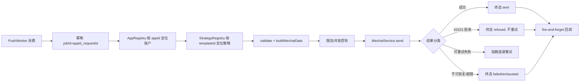

# 通用微信订阅消息推送服务方案

- 日期: 2026-10-25
- 状态: 已定稿
- 关联: docs/changelog/CHANGELOG.md#2026-10-25

## 背景

本项目定位为只负责微信小程序订阅消息推送的独立服务。需要对外提供 HTTP 接口，接收多个不同小程序的推送请求，经 BullMQ（Redis）队列可靠投递订阅消息，并在推送到达终态后回调对方接口做状态变更。要求结构可扩展：方便新增账户（小程序）、模板与业务逻辑，且不侵入核心链路。

## 目标

- **P0**
  - 对外提供统一 HTTP 推送接口，支持多小程序（`appid`）隔离。
  - 经 BullMQ + Redis 队列异步、可靠投递订阅消息（幂等、重试、死信）。
  - `access_token` 按 `appid` 缓存，绝不串用。
  - 推送到达终态后回调对方接口（fire-and-forget）。
- **P1**
  - 策略化业务扩展：新增账户/模板/业务逻辑不修改核心链路。
  - 微信接口限流（并发/频率控制）。
  - 结构化日志与结果观测（`requestId`、`appid`、`templateId`、`openid`、结果、耗时）。

## 方案

### 技术选型

- TypeScript + NestJS 11，包管理 `pnpm`。
- 队列：BullMQ + Redis，NestJS 集成用官方 `@nestjs/bullmq`（`Queue` 入队 / `Worker` 消费 / `QueueEvents` 观测）。
- 配置：**静态配置文件/环境变量**，无数据库、无管理接口，改配置重启生效。

### 模块划分

| 模块 | 职责 |
|------|------|
| `push` | HTTP 入口，DTO 校验 + `requestId` 幂等去重后入队；承载策略路由与 `StrategyRegistry` |
| `queue` | BullMQ 队列/Worker/QueueEvents 装配，重试/退避/死信，限流；终态触发回调 |
| `wechat` | `access_token` 获取与缓存、`subscribeMessage.send` 调用 |
| `app` | 静态配置加载为 `AppRegistry`（`appid` → 账户/模板/回调配置），回调地址解析 |
| `callback` | fire-and-forget 回调对方接口（异步 POST，不重试、不等待） |

> 说明：`src/` 中残留的旧「微信教育管理系统」代码（`family`/`child`/`course` 等）与本服务无关，属待清理遗留物，新代码按上述模块落位。

### 参数结构

#### ① 注册态配置（静态文件/环境变量，`app` 模块加载）

```yaml
# config/apps.yaml（示例）
apps:
  - appId: wx123
    name: 小程序A
    secret: <appsecret>
    callback:                       # 回调按小程序配置
      url: https://partner-a.com/notify/callback
    templates:                      # 模板白名单/元数据
      - templateId: tpl_xxx
        fields: [thing1, time2]     # 可选字段 schema，用于校验
  - appId: wx456
    name: 小程序B
    secret: <appsecret>
    callback: { url: https://partner-b.com/cb }
    templates: [ ... ]
```

- 新增账户 = 加一段 `apps` 配置 + 重启；新增模板 = 加一条 `templates` 配置。
- `AppRegistry: Map<appId, AppConfig>` 启动时构建，用于账户定位与回调地址解析。

#### ② 请求态（每次推送，HTTP body）

```jsonc
{
  "requestId": "uuid",            // 必填，幂等 key（→ BullMQ jobId）
  "appId": "wx123",               // 必填，小程序账户
  "templateId": "tpl_xxx",        // 必填，订阅消息模板（同时是业务路由 key）
  "openid": "oXXXX",              // 必填，接收者
  "data": { "student": "张三" },  // 必填，业务 data（策略负责组装成微信字段）
  "page": "pages/index/index",    // 可选，点击跳转页
  "miniprogramState": "formal",   // 可选 developer | trial | formal
  "lang": "zh_CN",                // 可选
  "callbackUrl": "https://..."    // 可选，覆盖 app 配置的回调地址
}
```

### 设计模式与业务扩展

| 设计模式 | 用在哪 | 解决的扩展点 |
|---------|--------|------------|
| **策略 + 注册表** | `PushStrategy` 接口 + `StrategyRegistry` | 新增业务/模板 = 新增策略类并注册，主链路零改动 |
| **模板方法** | `PushProcessor` 固定主链路 | 统一骨架，策略只填可变步骤（组装/校验/回调体） |
| **工厂** | `AppRegistry` 按 `appId` 获取账户配置、token 缓存 | 新增账户 = 工厂返回对应配置 |
| **适配器** | `WechatClient` 封装微信 API | 隔离微信 SDK/HTTP 差异 |
| **观察者（事件）** | 推送终态发布为结果事件 | 回调、日志、监控解耦 |

**策略接口（强策略：每个业务/模板必须实现）**

```ts
interface PushStrategy {
  readonly templateId: string;                    // 该策略处理的模板
  match(appId: string, templateId: string): boolean; // 可选 appId 约束
  buildWechatData(data: Record<string, unknown>, ctx: PushContext): WechatSubscribeData; // 业务 data → 微信字段
  validate?(data: Record<string, unknown>): void; // 可选校验（字段类型/长度）
}
```

- `StrategyRegistry: Map<templateId, PushStrategy>`，NestJS 依赖注入自动收集所有策略 provider。
- 未注册模板的策略 = 配置错误，请求被拒绝/任务失败。

**主链路（模板方法）**



### 回调（状态变更）

- **地址解析**：`request.callbackUrl` 优先，否则 `appConfig.callback.url`；两者都没有则不回调。
- **触发时机**：任务到达终态（`sent` / `refused` / `failed` / `exhausted`）时。
- **执行方式**：异步 `POST` JSON，**不 await、不重试、不进队列、无签名**；失败仅记日志。
- **回调体**（对方据此做状态变更，用 `requestId` 幂等去重）：

```jsonc
{
  "requestId": "uuid",
  "appId": "wx123",
  "templateId": "tpl_xxx",
  "openid": "oXXXX",
  "result": "sent",               // sent | refused | failed | exhausted
  "errcode": 0,
  "errmsg": "ok",
  "timestamp": "2026-10-25T21:00:00+08:00"
}
```

### 可靠性与限流

| 环节 | 策略 |
|------|------|
| 入队幂等 | `requestId` 作为 BullMQ jobId（用 `appId_requestId` 防跨账户撞 key；BullMQ 自定义 jobId 不允许 `:`） |
| 推送重试 | 指数退避重试，超限进死信；`QueueEvents` 观测结果与失败 |
| 结果分类 | `43101` 用户拒收不重试；`45009` 频率超限、`40001` token 失效退避重试（token 失效先刷新）；`47003`/`40003` 不可恢复直接失败 |
| token 缓存 | Redis 共享缓存，按 `appId` 隔离（多 Worker 共享，避免触发微信 token 接口频率限制） |
| 限流 | Worker `concurrency` + `limiter`（`max`/`duration`）控制订阅消息频率上限 |
| 回调 | 无重试、无保证（fire-and-forget） |

## 备选与权衡

| 决策点 | 备选 | 未选理由 |
|--------|------|---------|
| 账户/模板配置存储 | 数据库 + 管理接口；静态兜底 + 数据库覆盖 | 当前规模用静态配置最简，免去持久化与管理接口复杂度；动态性不是现阶段刚需 |
| 业务扩展形态 | 纯透传（服务不感知业务）；混合透传+策略 | 业务需要字段组装/校验等定制逻辑，强策略最清晰、可测试；纯透传无法做字段转换 |
| 回调可靠性 | 独立回调队列可靠投递；同步回调随主任务重试 | 需求明确为 fire-and-forget，无可靠性要求，故不引入回调队列/重试，降低复杂度 |
| token 缓存介质 | 进程内存；Redis + 内存降级 | Redis 共享缓存避免多实例重复拉 token 触发微信频率限制 |
| 回调签名 | 带 hmac 签名 | 需求明确不校验来源，故省略签名 |

## 决策

1. BullMQ + `@nestjs/bullmq` + Redis 做可靠队列投递。
2. 账户/模板/回调均走静态配置文件/环境变量，`app` 模块构建 `AppRegistry`。
3. 强策略模式：`templateId` 作为业务路由 key，每个业务/模板实现 `PushStrategy` 并注册到 `StrategyRegistry`；请求传 `appId + templateId + 业务 data`。
4. `requestId` 幂等（jobId 去重）；失败指数退避重试 + 死信；微信接口并发/频率限流；token 按 `appId` Redis 共享缓存。
5. 回调为 fire-and-forget：终态异步 POST，不重试、无签名，地址按 `request.callbackUrl ?? appConfig.callback.url` 解析。

## 影响范围

- 新增模块：`push`、`queue`、`wechat`、`app`、`callback`（按 AGENTS.md 目标架构）。
- 配置：新增小程序账户/模板/回调的配置文件（或环境变量）。
- 数据：无数据库依赖（订阅消息推送不落库；如需审计可后续加日志/监控侧存储）。
- 清理：`src/` 旧「微信教育管理系统」模块（`family`/`child`/`course` 等）为遗留物，待清理，与新服务无关。
